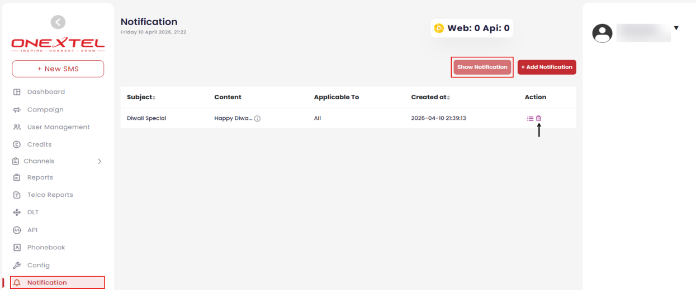

Notifications are messages you publish to the people who use the platform — planned maintenance,
policy changes, a campaign freeze over a holiday period. They are addressed to platform users,
not to message recipients.

Each notification shows its subject, content, target audience, and creation time.

## Add a notification

<Steps>
  <Step title="Open Notification">
    In the left pane, click **Notification**.
  </Step>
  <Step title="Start a new one">
    Click **+ Add Notification**.
  </Step>
  <Step title="Enter the details">
    Enter the **Subject** and **Content**, then choose **Applicable To**:

    | Option | Who sees it |
    | --- | --- |
    | All | Every account under you |
    | TUC with children | One TUC and its sub-accounts. Enter the Tenant/TUC ID |
    | Specific TUC | One TUC only. Enter the Tenant/TUC ID |
  </Step>
  <Step title="Save">
    Click **Add**. The notice appears under the bell icon in the header for those users.
  </Step>
</Steps>

## View notifications

In the left pane, click **Notification**, then **Show Notification** to list them.

<Frame caption="Notification list">
  
</Frame>

## Edit a notification

<Steps>
  <Step title="Open the list">
    Click **Notification**, then **Show Notification**.
  </Step>
  <Step title="Open the edit action">
    In the **Action** column, click the ellipsis (**...**) icon.
  </Step>
  <Step title="Save">
    Make your changes and click **Update**.
  </Step>
</Steps>

## Delete a notification

<Steps>
  <Step title="Open the list">
    Click **Notification**, then **Show Notification**.
  </Step>
  <Step title="Delete">
    In the **Action** column, click the **Delete** icon next to the notification.
  </Step>
  <Step title="Confirm">
    A warning appears. Click **Delete**.
  </Step>
</Steps>

## Related

- [Account settings](/guides/platform/account-settings) — for personal credit alerts
- [Platform overview](/guides/platform/overview)
