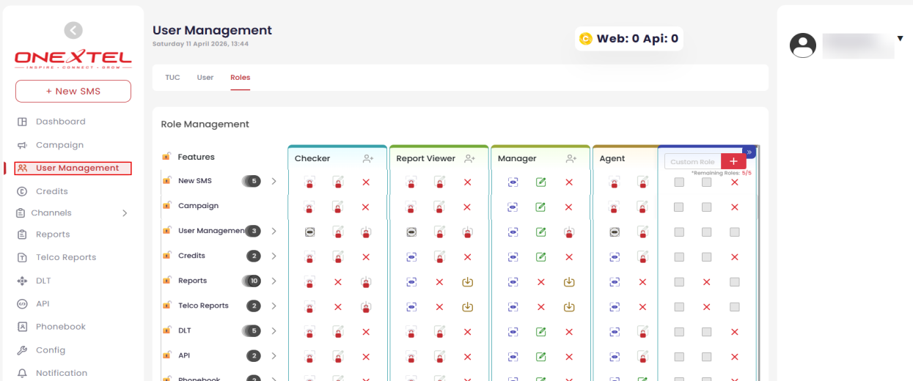

Roles control what a user can do. Rather than granting blanket access, each role sets
permissions feature by feature — so a reporting analyst can read campaign data without being
able to send messages or change account settings.

## Built-in roles

| Role | Typical use |
| --- | --- |
| Admin | Full access, including user management and account settings |
| Manager | Day-to-day operation — campaigns, templates, reports |
| Agent | Sending and handling messages |
| Sales | Sales users |
| Report Viewer | Read-only access to reports |

If none fits, create up to 5 custom roles — see [Create a custom role](#create-a-custom-role).

## Campaign maker-checker

Maker-checker splits campaign sending between two people, so no single user can create and send a
WhatsApp or RCS campaign alone. Regulated customers such as banks often require it.

Your tenant administrator switches maker-checker on for your account. Each user then also gets a
**Maker** or **Checker** role type (an Admin can be either):

<Steps>
  <Step title="The maker creates the campaign">
    When a maker clicks **Launch**, the campaign goes to `Pending`.
  </Step>
  <Step title="The checker reviews it">
    The checker opens the campaign and clicks **Approve** or **Reject**.
  </Step>
  <Step title="The checker launches it">
    An `Approved` campaign is launched by the checker. A `Rejected` or `Pending` campaign can be
    edited and resubmitted.
  </Step>
</Steps>

If maker-checker is switched off, `Pending` and `Rejected` campaigns go back to `Draft`.

## Permissions

Permissions are granted per feature, across three actions:

| Action | Allows |
| --- | --- |
| View | Seeing the feature and its data |
| Edit | Creating and changing records |
| Download | Exporting data out of the platform |

The features that can be controlled include New SMS, Campaign, User Management, Credits, Reports,
Telco Reports, DLT, API, Phonebook, Notification, All Schedule, WhatsApp and RCS. The number next
to a feature in the matrix is how many permissions it has — for WhatsApp, for example, viewing
and creating templates are separate permissions.

<Frame caption="Role Management matrix">
  
</Frame>

<Note>
**Download** is deliberately separate from **View**. A user can be allowed to read reports on
screen without being able to export recipient data — useful where the data is sensitive and
should not leave the platform. Pair it with the Mask Phone and Mask Content settings described
in [Platform overview](/guides/platform/overview#data-masking).
</Note>

## Create a custom role

When none of the built-in roles fits, create your own.

<Steps>
  <Step title="Open the Roles tab">
    Click **User Management**, then select the **Roles** tab. The Role Management matrix shows
    each existing role as a column and each feature as a row.
  </Step>
  <Step title="Name the role">
    Enter the role name in the **Custom Role** section. You can have up to 5 custom roles; the
    panel shows how many are left, for example `4/5`.
  </Step>
  <Step title="Set the permissions">
    For each feature, select the **View**, **Edit**, and **Download** checkboxes you want to
    grant. Anything left unchecked is denied.
  </Step>
  <Step title="Add it">
    Click **+**.
  </Step>
  <Step title="Create">
    Click **Create** in the pop-up. A confirmation message appears once the role is saved.
  </Step>
</Steps>

## Assign a role to a user

<Steps>
  <Step title="Find the user">
    Click **User Management**, select the **User** tab, and enter the username in the **Search
    by** field.
  </Step>
  <Step title="Open the user">
    In the Action column, click the **Ellipsis** icon for that user.
  </Step>
  <Step title="Set the role">
    Under **Roles** in the User Info section, select or deselect the **Role Type** to grant or
    remove it.
  </Step>
  <Step title="Update">
    Click **Update**.
  </Step>
</Steps>

Roles can also be set when the user is first created — see
[Add a user](/guides/platform/user-management#add-a-user).

<Tip>
Give each user the fewest rights they need. Keep **Download** for people who need customer data,
and separate the campaign maker and checker for regulated customers.
</Tip>

## Related

- [User management](/guides/platform/user-management)
- [Platform overview](/guides/platform/overview)
