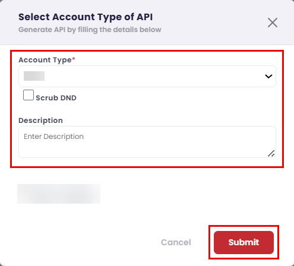
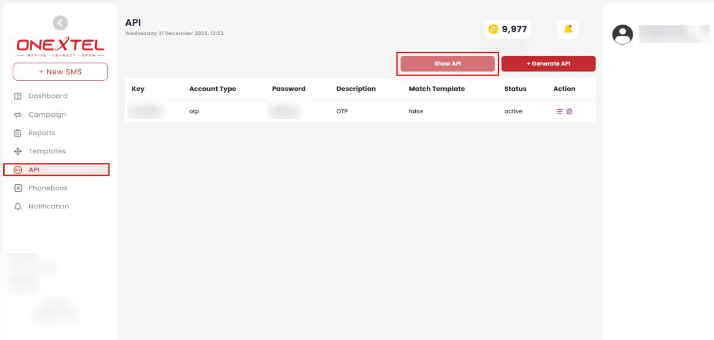
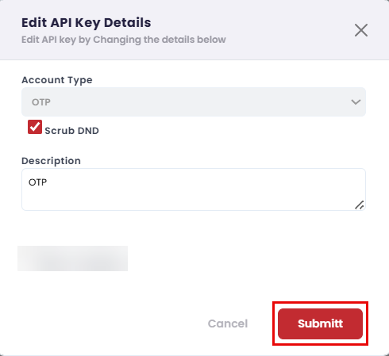

The **API** menu creates the keys your applications use to send SMS through the [International SMS API](/api-reference/sms-international/overview). Pass the key as the `key` field in the request body.

## Generate an API key

<Steps>
  <Step title="Open the API tab">
    In the left pane, click **API**, then click the **API** tab.
  </Step>
  <Step title="Generate">
    Click **+Generate API**.
  </Step>
  <Step title="Set up the key">
    In the pop-up, select the **Account Type**. Select **Scrub DND** to exclude DND recipients from messages sent with this key. Enter a **Description**.
  </Step>
  <Step title="Submit">
    Click **Submit**. The portal generates the API key.
  </Step>
</Steps>

<Frame caption="Generate API">
  
</Frame>

## View API keys

In the left pane, click **API**, click the **API** tab, then click **Show API**. The portal lists your keys with their account type, description, and status.

<Frame caption="API key list">
  
</Frame>

## Edit an API key

<Steps>
  <Step title="Open the key list">
    In the left pane, click **API**, then click **Show API**.
  </Step>
  <Step title="Open the key">
    In the **Action** column, click the ellipsis icon.
  </Step>
  <Step title="Save your changes">
    Change **Scrub DND** or the **Description**, then click **Submit**. The portal updates the key.
  </Step>
</Steps>

<Note>
  You can't change the **Account Type** of an existing key. Generate a new key instead.
</Note>

<Frame caption="Edit API Key Details">
  
</Frame>

## Delete an API key

<Steps>
  <Step title="Open the key list">
    In the left pane, click **API**, then click **Show API**.
  </Step>
  <Step title="Delete">
    In the **Action** column, click the **Delete** icon.
  </Step>
</Steps>
