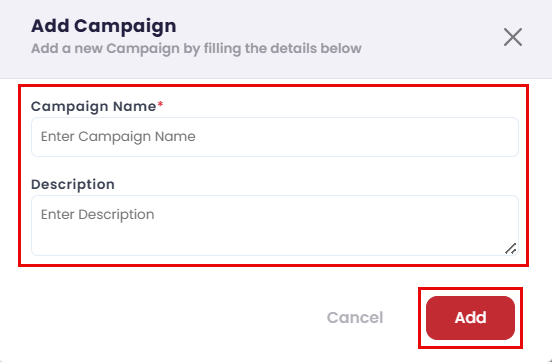
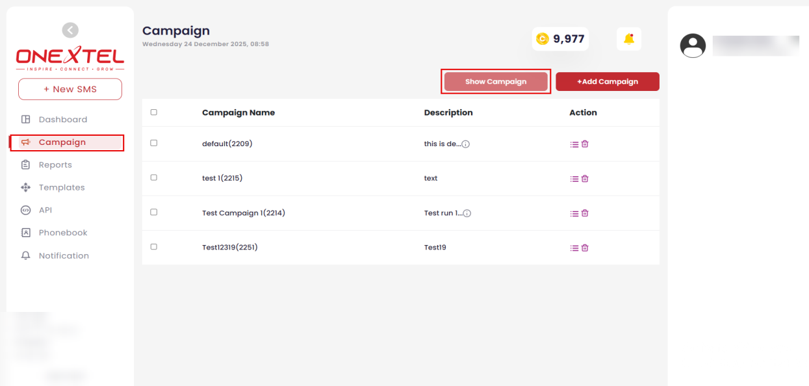
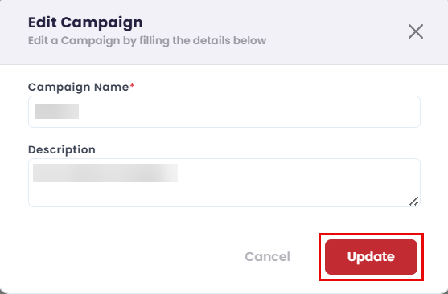
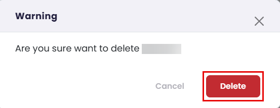

A campaign groups related messages so you can schedule them, target an audience, and track delivery and engagement in [Reports](/guides/sms-international/reports). Every SMS type asks for a campaign name, so create the campaign here before you [send](/guides/sms-international/send-sms).

## Add a campaign

<Steps>
  <Step title="Open Campaign">
    In the left pane, click **Campaign**, then click **+Add Campaign**.
  </Step>
  <Step title="Enter the campaign details">
    In the pop-up, enter the **Campaign Name** and a **Description**.
  </Step>
  <Step title="Save">
    Click **Add**. The portal adds the campaign.
  </Step>
</Steps>

<Frame caption="Add Campaign">
  
</Frame>

## View campaigns

In the left pane, click **Campaign**, then click **Show Campaign**. The portal lists your campaigns and their details.

<Frame caption="Campaign list">
  
</Frame>

## Edit a campaign

<Steps>
  <Step title="Open the campaign list">
    In the left pane, click **Campaign**, then click **Show Campaign**.
  </Step>
  <Step title="Open the campaign">
    In the **Action** column, click the ellipsis icon.
  </Step>
  <Step title="Save your changes">
    Make the changes and click **Update**. The portal updates the campaign.
  </Step>
</Steps>

<Frame caption="Edit Campaign">
  
</Frame>

## Delete a campaign

<Steps>
  <Step title="Open the campaign list">
    In the left pane, click **Campaign**, then click **Show Campaign**.
  </Step>
  <Step title="Delete">
    In the **Action** column, click the **Delete** icon.
  </Step>
  <Step title="Confirm">
    In the warning pop-up, click **Delete**. The portal deletes the campaign.
  </Step>
</Steps>

<Frame caption="Delete confirmation">
  
</Frame>
