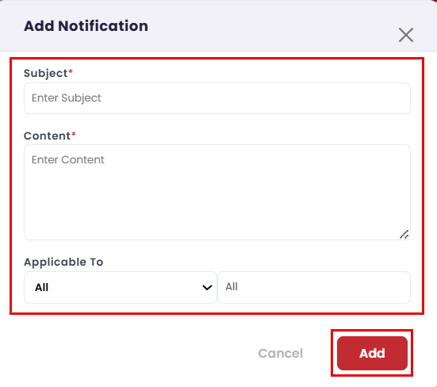
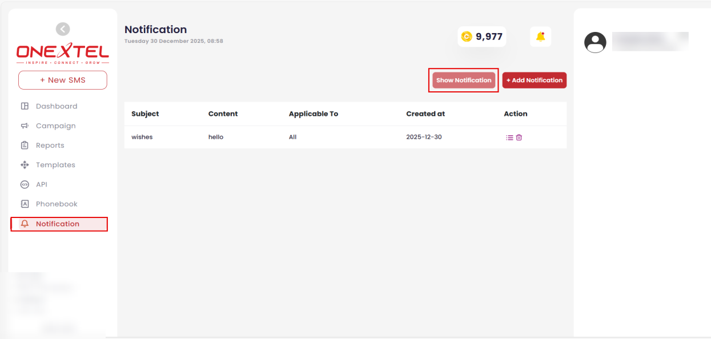
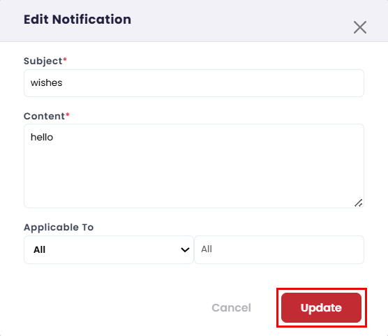

The **Notification** menu creates and manages messages shown to users of the portal. Each notification has a subject, content, the users it applies to, and the time it was created.

## Add a notification

<Steps>
  <Step title="Open Notification">
    In the left pane, click **Notification**, then click **+Add Notification**.
  </Step>
  <Step title="Write the notification">
    In the **Add Notification** pop-up, enter the **Subject** and **Content**.
  </Step>
  <Step title="Choose who sees it">
    In **Applicable To**, select **All**, or a particular TUC.
  </Step>
  <Step title="Save">
    Click **Add**. The portal adds the notification.
  </Step>
</Steps>

<Frame caption="Add Notification">
  
</Frame>

## View notifications

In the left pane, click **Notification**, then click **Show Notification**. The portal lists your notifications.

<Frame caption="Notification list">
  
</Frame>

## Edit a notification

<Steps>
  <Step title="Open the notification list">
    In the left pane, click **Notification**, then click **Show Notification**.
  </Step>
  <Step title="Open the notification">
    In the **Action** column, click the ellipsis icon.
  </Step>
  <Step title="Save your changes">
    Make the changes and click **Update**. The portal updates the notification.
  </Step>
</Steps>

<Frame caption="Edit Notification">
  
</Frame>

## Delete a notification

<Steps>
  <Step title="Open the notification list">
    In the left pane, click **Notification**, then click **Show Notification**.
  </Step>
  <Step title="Delete">
    In the **Action** column, click the **Delete** icon for the notification you want to remove.
  </Step>
  <Step title="Confirm">
    In the warning pop-up, click **Delete**. The portal removes the notification.
  </Step>
</Steps>
