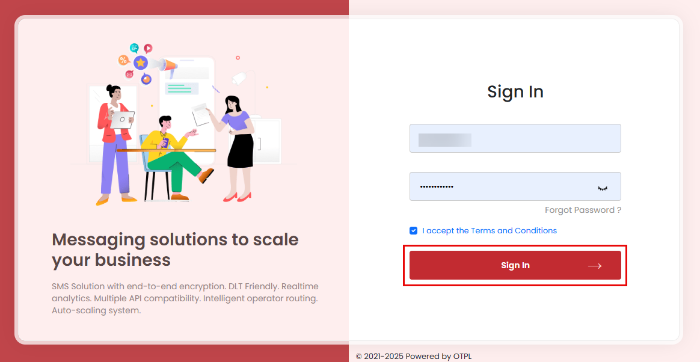
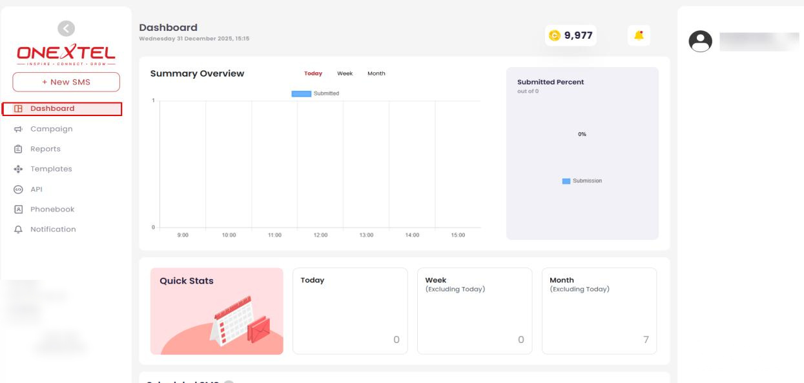

The OneXtel International SMS portal is where you send SMS to international destinations, run campaigns, manage sender IDs, templates and contacts, generate API keys, and download delivery reports.

This section follows the portal menu in the left pane, in order:

| Menu | What you do there | Guide |
| --- | --- | --- |
| **+ New SMS** | Send Quick English, Quick Unicode/Multilingual, Dynamic, Multiple Dynamic, and Campaign SMS | [Send SMS](/guides/sms-international/send-sms) |
| **Campaign** | Create, view, edit, and delete campaigns | [Campaigns](/guides/sms-international/campaigns) |
| **Reports** | MIS, Summary, Campaign Summary, Search, Sender ID Summary, Clicker Data, Clicker Details | [Reports](/guides/sms-international/reports) |
| **Templates** | Sender IDs, templates, and bulk template upload | [Sender IDs](/guides/sms-international/sender-ids), [Templates](/guides/sms-international/templates) |
| **API** | Generate, view, edit, and delete API keys | [API keys](/guides/sms-international/api-keys) |
| **Phonebook** | Contact groups and contacts | [Phonebook](/guides/sms-international/phonebook) |
| **Notification** | Notifications shown to users | [Notifications](/guides/sms-international/notifications) |
| User icon (top right) | My Account, Alerts, Change Password, Login History, Log Out | [Profile settings](/guides/sms-international/profile-settings) |

To send SMS from your own application instead of the portal, see the [International SMS API](/api-reference/sms-international/overview).

## Sign in

<Steps>
  <Step title="Open the portal">
    Open a web browser and go to the OneXtel International SMS portal URL.
  </Step>
  <Step title="Enter your credentials">
    Enter your **Username** and **Password**.
  </Step>
  <Step title="Accept the terms">
    Select the **I accept the Terms and Conditions** checkbox.
  </Step>
  <Step title="Sign in">
    Click **Sign In**. After successful authentication, the **Dashboard** appears.
  </Step>
</Steps>

<Frame caption="Sign in page">
  
</Frame>

## Dashboard

The **Dashboard** shows your message traffic on an hourly, daily, and monthly basis, so you can monitor SMS activity in real time.

<Frame caption="Dashboard">
  
</Frame>

## Key terms

| Term | Definition |
| --- | --- |
| TUC (Tenant User Customer) | A primary account that manages and delivers SMS services independently. |
| Child TUC | A secondary account that manages SMS services under the primary account. |
| Reseller / Sub-account module | An account that manages multiple SMS accounts. |
| Credits | The total number of messages an account can send. One credit equals one 160-character message. Unicode or long messages consume multiple credits, based on the number of message segments per request. |
| UU ID | A unique ID that identifies each SMS sent to a recipient. |

## Getting help

Email [support@OneXtel.com](mailto:support@OneXtel.com).
