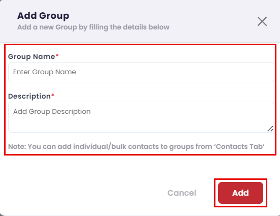
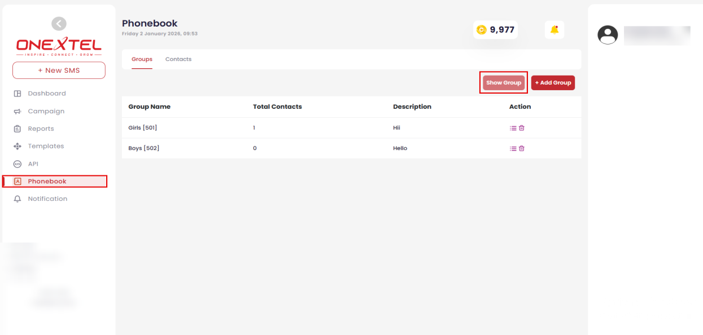
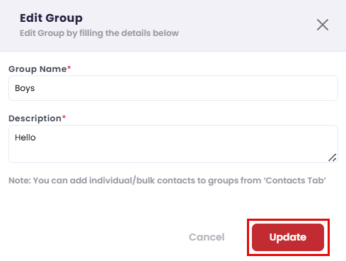
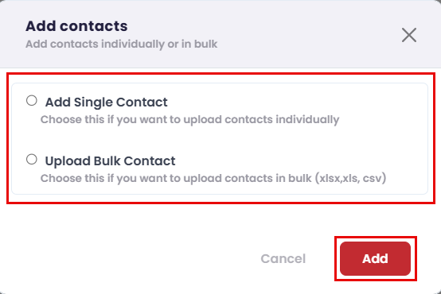
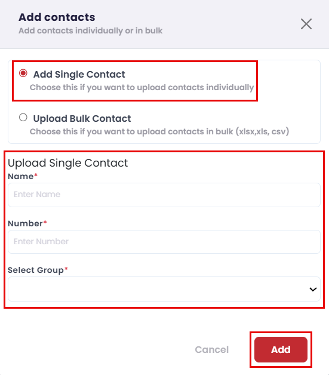
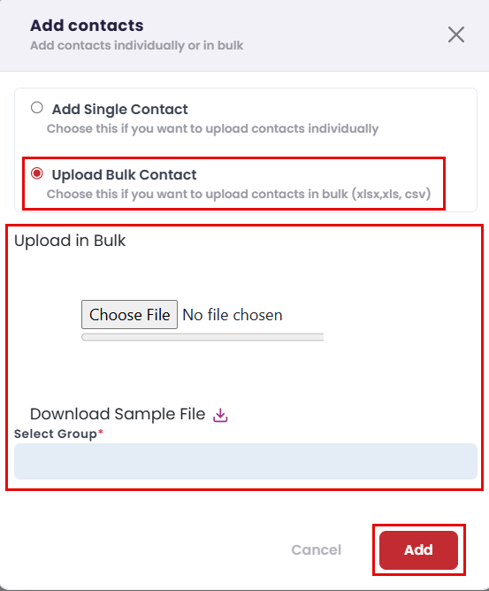
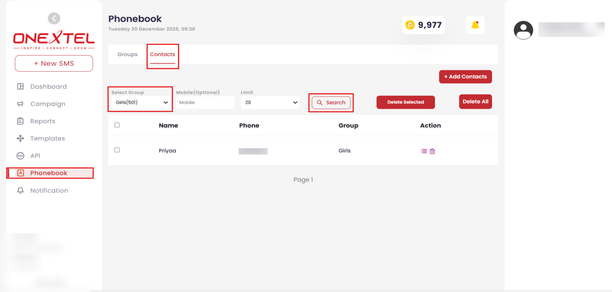

The phonebook stores your contacts in the portal, so you can pick recipients when you [send SMS](/guides/sms-international/send-sms) without switching to another application. It has two tabs:

| Tab | Purpose |
| --- | --- |
| **Groups** | Organise contacts into groups. Each group can hold one or more contacts. |
| **Contacts** | Individual records with name, mobile number, and group. Add them one at a time or upload them in bulk. |

## Groups

### Add a group

<Steps>
  <Step title="Open the Groups tab">
    In the left pane, click **Phonebook**, then click the **Groups** tab.
  </Step>
  <Step title="Add a group">
    Click **+ Add Group**.
  </Step>
  <Step title="Enter the group details">
    In the pop-up, enter the **Group Name** and a short **Description**.
  </Step>
  <Step title="Save">
    Click **Add**. The portal creates the group.
  </Step>
</Steps>

<Frame caption="Add Group">
  
</Frame>

### View groups

In the left pane, click **Phonebook**, click the **Groups** tab, then click **Show Group**. The portal lists your groups with the number of contacts in each.

<Frame caption="Group list">
  
</Frame>

### Edit a group

<Steps>
  <Step title="Open the group list">
    In the left pane, click **Phonebook**, click the **Groups** tab, then click **Show Group**.
  </Step>
  <Step title="Open the group">
    In the **Action** column, click the ellipsis icon.
  </Step>
  <Step title="Save your changes">
    Make the changes and click **Update**. The portal updates the group.
  </Step>
</Steps>

<Frame caption="Edit Group">
  
</Frame>

### Delete a group

<Steps>
  <Step title="Open the group list">
    In the left pane, click **Phonebook**, click the **Groups** tab, then click **Show Group**.
  </Step>
  <Step title="Delete">
    In the **Action** column, click the **Delete** icon.
  </Step>
  <Step title="Confirm">
    In the warning pop-up, click **Delete**. The portal deletes the group.
  </Step>
</Steps>

## Contacts

### Add contacts

<Steps>
  <Step title="Open the Contacts tab">
    In the left pane, click **Phonebook**, then click the **Contacts** tab.
  </Step>
  <Step title="Add contacts">
    Click **+ Add Contacts**. In the pop-up, select **Add Single Contact** or **Upload Bulk Contact**.
  </Step>
  <Step title="Enter the contacts">
    - **Add Single Contact**: enter the **Name** and **Number**, then select the group in **Select Group**.
    - **Upload Bulk Contact**: click **Choose File**, select an XLSX, XLS, or CSV file, and click **Open**. Then select the group in **Select Group**. Click **Download Sample File** for the expected layout.
  </Step>
  <Step title="Save">
    Click **Add**. The portal adds the contacts to the phonebook.
  </Step>
</Steps>

<Frame caption="Add contacts">
  
</Frame>

<Columns cols={2}>
  <Frame caption="Add Single Contact">
    
  </Frame>
  <Frame caption="Upload Bulk Contact">
    
  </Frame>
</Columns>

### View contacts

<Steps>
  <Step title="Open the Contacts tab">
    In the left pane, click **Phonebook**, then click the **Contacts** tab.
  </Step>
  <Step title="Filter">
    Select the group in **Select Group**. Optionally, enter a mobile number in **Mobile**.
  </Step>
  <Step title="Search">
    Click **Search**. The portal lists the matching contacts.
  </Step>
</Steps>

<Note>
  If you select **All** in **Select Group**, enter the mobile number of the contact you want.
</Note>

<Frame caption="Contact list">
  
</Frame>

### Edit a contact

<Steps>
  <Step title="Find the contact">
    In the left pane, click **Phonebook**, click the **Contacts** tab, select the group, and click **Search**.
  </Step>
  <Step title="Open the contact">
    In the **Action** column, click the ellipsis icon.
  </Step>
  <Step title="Save your changes">
    Make the changes and click **Update**. The portal updates the contact.
  </Step>
</Steps>

### Delete contacts

<Steps>
  <Step title="Find the contact">
    In the left pane, click **Phonebook**, click the **Contacts** tab, select the group, and click **Search**.
  </Step>
  <Step title="Delete">
    In the **Action** column, click the **Delete** icon, then click **Delete** in the warning pop-up. To delete several contacts at once, click **Delete Selected** or **Delete All**.
  </Step>
</Steps>
