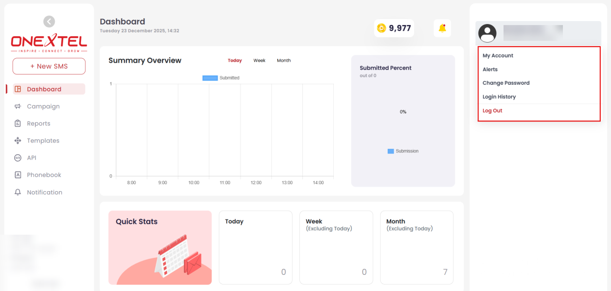
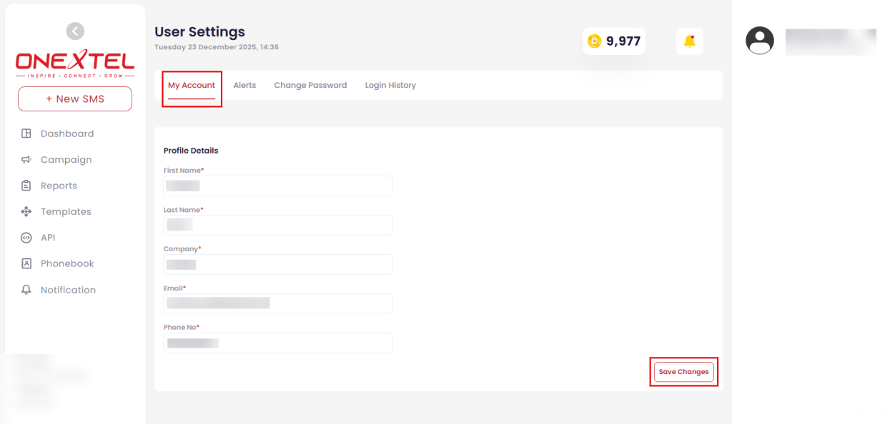
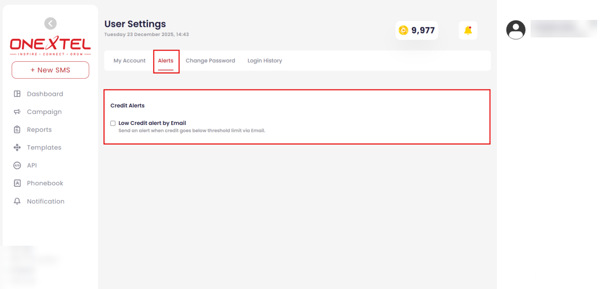
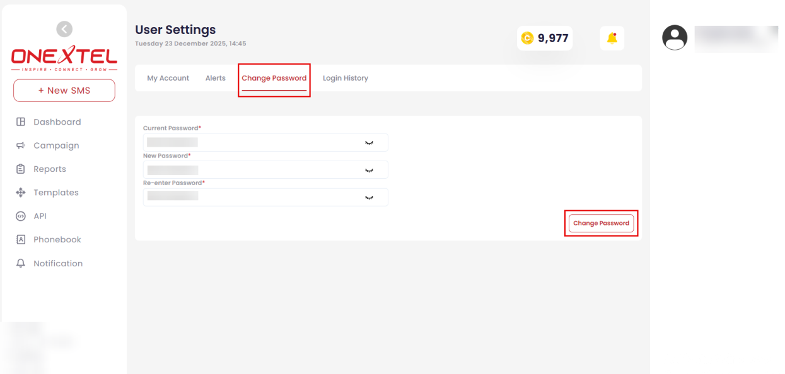

Click the user icon with your name at the top right of the portal to open your settings. Five options appear:

| Option | What it does |
| --- | --- |
| [My Account](#my-account) | Shows and updates your profile details |
| [Alerts](#alerts) | Sets credit alerts |
| [Change Password](#change-password) | Changes your current password |
| [Login History](#login-history) | Shows your login history |
| Log Out | Signs you out of the portal |

<Frame caption="User menu">
  
</Frame>

## My Account

<Steps>
  <Step title="Open My Account">
    Click **My Account**.
  </Step>
  <Step title="Update your details">
    Update your name, email address, and mobile number.
  </Step>
  <Step title="Change the logo">
    To change your logo or icon, click **Select File**, choose the image in the file manager, and click **Open**.
  </Step>
  <Step title="Save">
    Click **Save Changes**.
  </Step>
</Steps>

<Frame caption="My Account">
  
</Frame>

## Alerts

Click **Alerts**, then select **Low Credit Alert** to get an email when your account's credits run low.

<Frame caption="Alerts">
  
</Frame>

## Change Password

<Steps>
  <Step title="Open Change Password">
    Click **Change Password**.
  </Step>
  <Step title="Enter the passwords">
    Enter your current password, enter the new password, and re-enter the new password.
  </Step>
  <Step title="Save">
    Click **Change Password**.
  </Step>
</Steps>

<Frame caption="Change Password">
  
</Frame>

## Login History

Click **Login History**, then click **Show Login History**. The portal shows the IP address and login time of each sign-in to your account.
