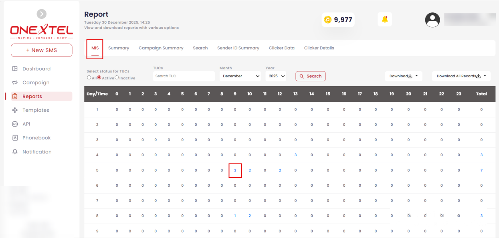
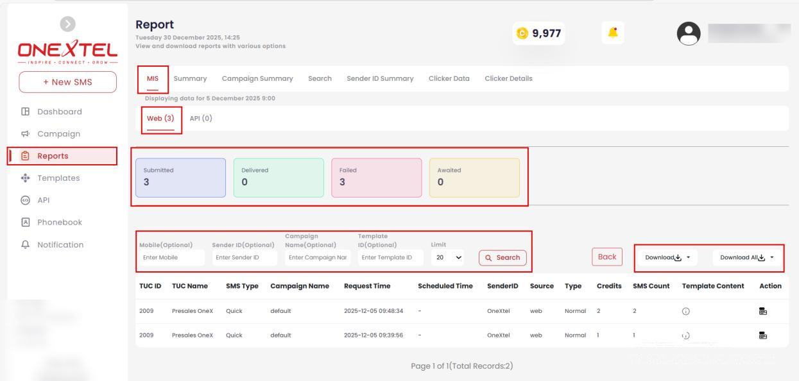
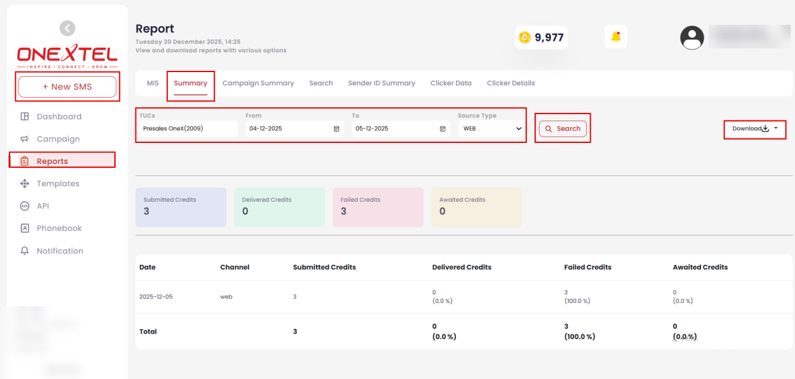
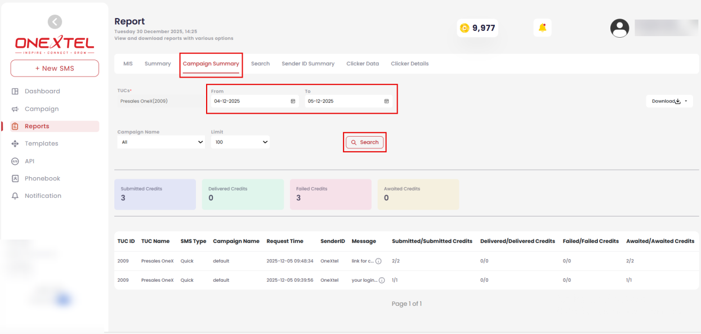
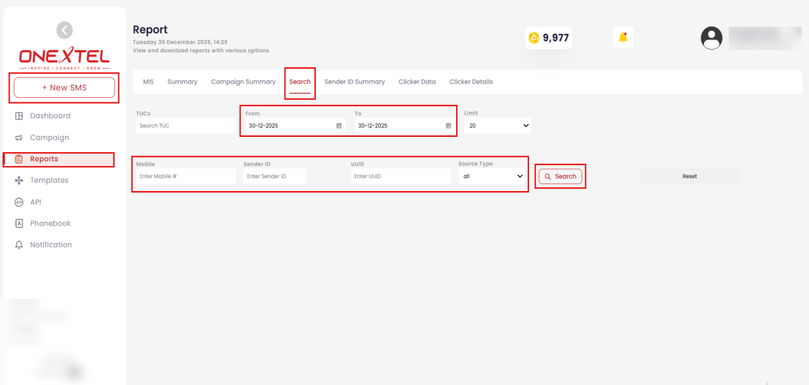
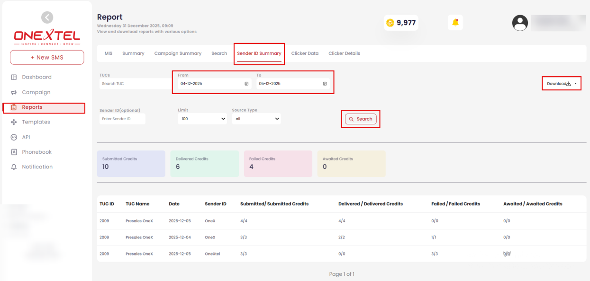
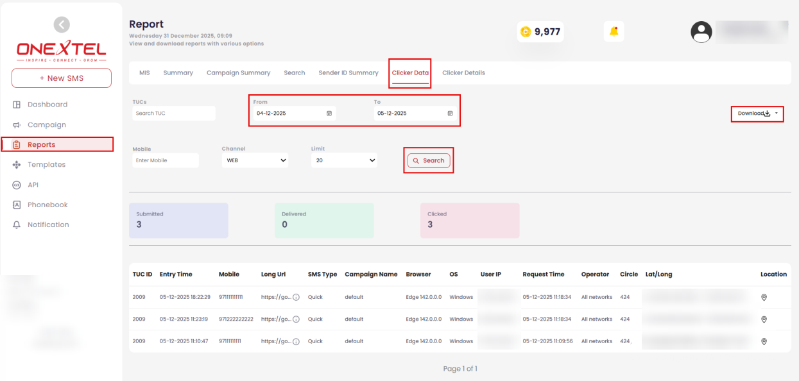
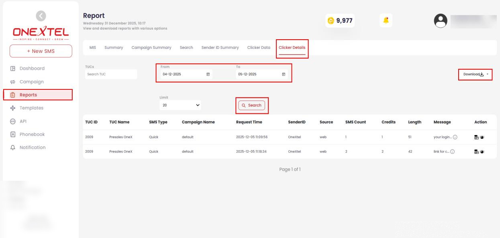

**Reports** generates detailed reports by date range, sender ID, and campaign, so you can analyse SMS performance, track delivery, and find delivery issues. Each report is a tab under **Reports**, and every report downloads as CSV or XLSX.

| Report | What it shows |
| --- | --- |
| [MIS](#mis-report) | SMS delivery counts by hour and day |
| [Summary](#summary) | SMS counts and delivery status with percentage breakdowns, with message and account details, for a date range |
| [Campaign Summary](#campaign-summary) | Campaign performance: delivered, submitted, failed, and awaited messages, by SMS type |
| [Search](#search) | Message-level detail, filtered by multiple criteria |
| [Sender ID Summary](#sender-id-summary) | SMS activity for each sender ID linked to the account |
| [Clicker Data](#clicker-data) | How recipients interacted with links in your SMS: IP address, browser, operator, circle, and coordinates |
| [Clicker Details](#clicker-details) | Campaign-level click reports by mobile number, with user details, TUC ID, TUC name, and campaign name |

## MIS report

The MIS report is a grid of dates in rows and hours in columns. Each cell is the number of SMS delivered in that hour, and the final column is the total sent that day. Use it to spot volume patterns and to find undelivered SMS or sender ID problems.

<Steps>
  <Step title="Open the MIS tab">
    In the left pane, click **Reports**, then click the **MIS** tab.
  </Step>
  <Step title="Drill into a count">
    Click any active hourly count or daily total. The portal opens the **Web** subtab.
  </Step>
  <Step title="Choose the sending method">
    Click **Search**. The portal shows how many SMS were sent through the Web and the API. Select **Web** or **API** to see the detail for that sending method.
  </Step>
  <Step title="Filter">
    Filter by **Mobile**, **Sender ID**, **Campaign Name**, **Template ID**, and **Limit** (the number of entries per page), then click **Search**.
  </Step>
  <Step title="Download">
    Click **Download** for campaign-wise data, or **Download All** for the complete dataset, and select CSV or XLSX from the dropdown list.
  </Step>
</Steps>

<Frame caption="MIS report">
  
</Frame>

<Frame caption="MIS detail with Web and API subtabs">
  
</Frame>

## Summary

Shows delivered SMS counts and statuses with percentage values, and lists delivered SMS for each child account in the selected date range.

<Steps>
  <Step title="Open the Summary tab">
    In the left pane, click **Reports**, then click the **Summary** tab.
  </Step>
  <Step title="Set the filters">
    Select the **TUC** from the dropdown list, select the date range, and select the **Source Type** of the SMS.
  </Step>
  <Step title="Download">
    Click **Download** and select CSV or XLSX from the dropdown list.
  </Step>
</Steps>

<Frame caption="Summary report">
  
</Frame>

## Campaign Summary

Shows campaign performance: delivered, submitted, failed, and awaited messages, and the types of SMS sent.

<Steps>
  <Step title="Open Campaign Summary">
    In the left pane, click **Reports**, then click **Campaign Summary**.
  </Step>
  <Step title="Search">
    Select the date range and click **Search**. The portal displays the campaign details.
  </Step>
  <Step title="Download">
    Click **Download** and select CSV or XLSX from the dropdown list.
  </Step>
</Steps>

<Frame caption="Campaign Summary report">
  
</Frame>

## Search

Filters report data by several criteria to find specific messages.

<Steps>
  <Step title="Open Search">
    In the left pane, click **Reports**, then click **Search**.
  </Step>
  <Step title="Set the filters">
    Select the date range and enter the fields below.
  </Step>
  <Step title="Search">
    Click **Search**. The portal displays the matching messages.
  </Step>
  <Step title="Download">
    Click **Download** and select CSV or XLSX from the dropdown list.
  </Step>
</Steps>

| Field | Description |
| --- | --- |
| TUC Name | The Tenant User Customer (TUC) associated with the message. |
| Sender ID | The approved sender identity used to send the message. |
| UU ID | The unique identifier assigned to each message, for tracking and reference. |
| Source Type | The channel the message was sent through: Web, API, or SMPP. |

<Frame caption="Search report">
  
</Frame>

## Sender ID Summary

Shows SMS sent through each sender ID. Search by sender ID or TUC name to list every sender ID linked to the account in the selected date range.

<Steps>
  <Step title="Open Sender ID Summary">
    In the left pane, click **Reports**, then click **Sender ID Summary**.
  </Step>
  <Step title="Search">
    Select the date range and click **Search**. The portal displays the TUC ID, TUC name, and credits for each sender ID.
  </Step>
  <Step title="Download">
    Click **Download** and select CSV or XLSX from the dropdown list.
  </Step>
</Steps>

<Frame caption="Sender ID Summary report">
  
</Frame>

## Clicker Data

Shows how recipients interacted with links in your SMS: IP address, browser, operator, circle, and geographic coordinates. Use it to analyse customer behaviour and interaction patterns.

<Steps>
  <Step title="Open Clicker Data">
    In the left pane, click **Reports**, then click **Clicker Data**.
  </Step>
  <Step title="Search">
    Select the date range and click **Search**. The portal displays details such as the TUC ID, SMS type, and campaign name.
  </Step>
  <Step title="Download">
    Click **Download** and select CSV or XLSX from the dropdown list.
  </Step>
</Steps>

<Frame caption="Clicker Data report">
  
</Frame>

## Clicker Details

Generates campaign reports for clicked links by mobile number, with the user's IP address, browser, operator, circle, latitude, and longitude, plus the TUC ID, TUC name, and campaign name. Use it to identify where customers are.

<Steps>
  <Step title="Open Clicker Details">
    In the left pane, click **Reports**, then click **Clicker Details**.
  </Step>
  <Step title="Search">
    Select the date range and click **Search**. The portal displays details such as the TUC ID, SMS type, and campaign name.
  </Step>
  <Step title="Download">
    Click **Download** and select CSV or XLSX from the dropdown list.
  </Step>
</Steps>

<Frame caption="Clicker Details report">
  
</Frame>
