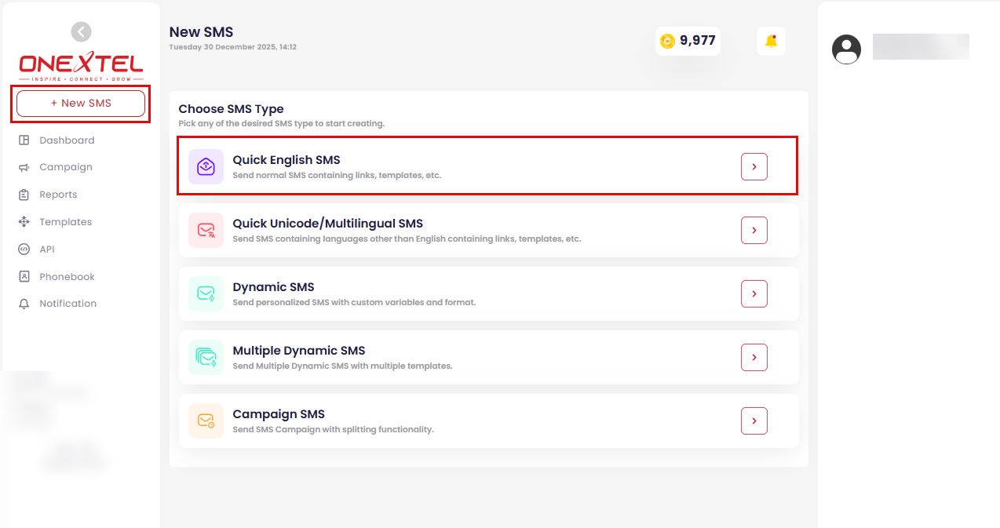
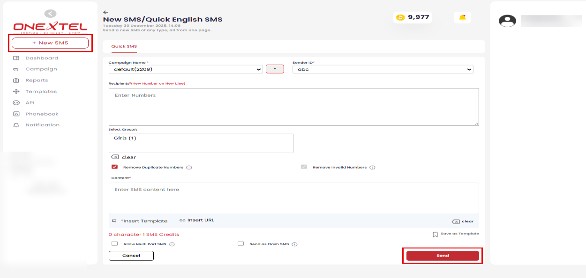
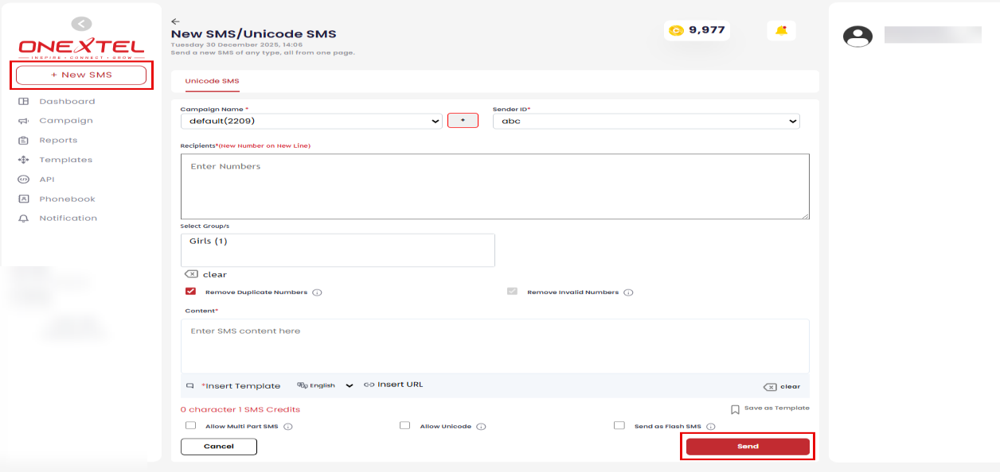
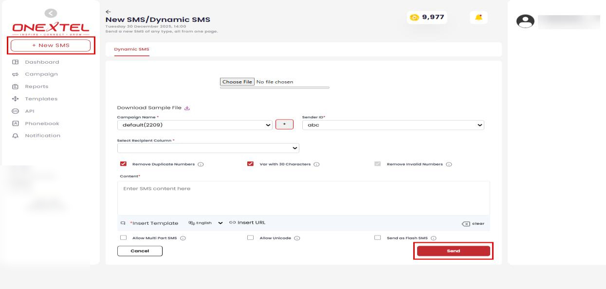
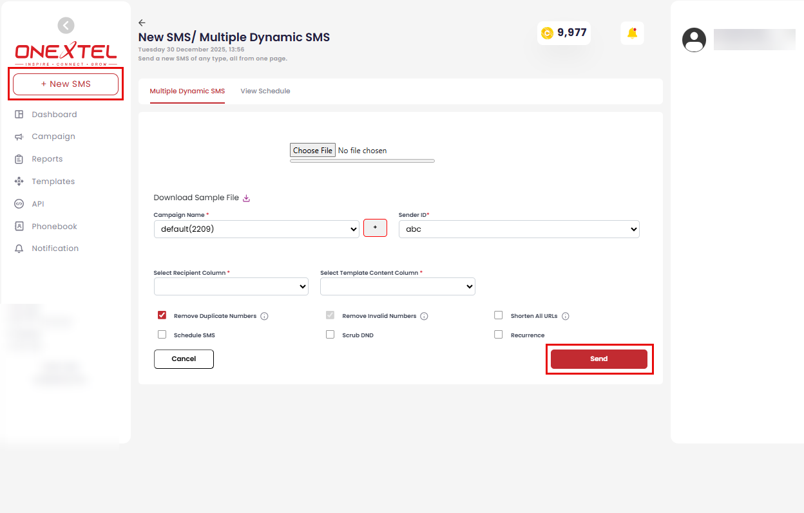
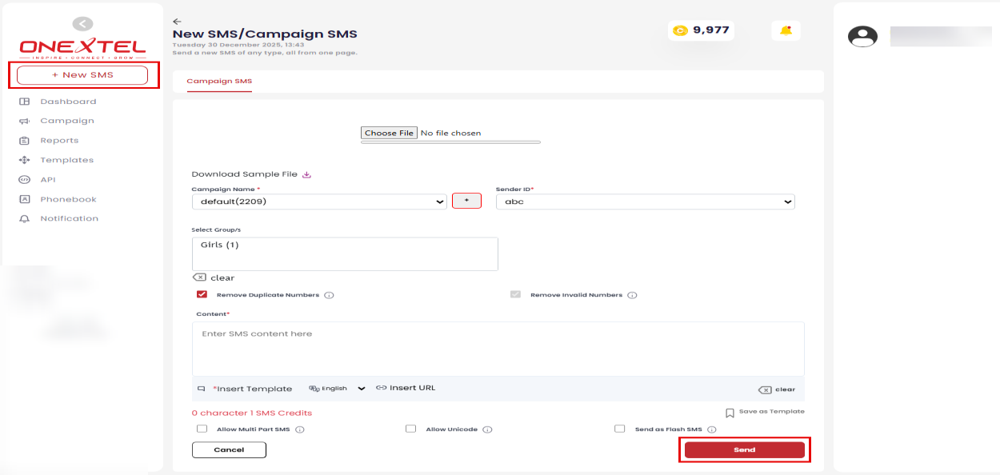

Click **+ New SMS** in the left pane to choose one of five SMS types.

| SMS type | Use it to | Recipients per send |
| --- | --- | --- |
| [Quick English SMS](#quick-english-sms) | Send a text message, schedule it, and import contacts from the phonebook or a pasted list | Up to 100,000 |
| Quick Unicode/Multilingual SMS | Send in multiple languages, schedule, and import contacts | Up to 100,000 |
| [Dynamic SMS](#dynamic-sms) | Send a message with multiple variables, importing numbers and variable data from an Excel sheet | Up to 2,000,000 |
| [Multiple Dynamic SMS](#multiple-dynamic-sms) | Send using multiple templates from a single Excel sheet | Up to 2,000,000 |
| [Campaign SMS](#campaign-sms) | Run a bulk campaign with multiple variables and numbers imported from an Excel sheet | Up to 2,000,000 |

<Note>
  The recipient limit applies to a single-part SMS and decreases as the number of message parts increases. A two-part SMS supports half the limit: 50,000 recipients for Quick SMS, and 1,000,000 for Dynamic, Multiple Dynamic, and Campaign SMS.
</Note>

<Frame caption="Choose SMS Type">
  
</Frame>

## Before you send

Every SMS type ends with the same confirmation. After you click **Send**, a pop-up summarises the message before anything goes out:

- Invalid numbers
- Blacklisted numbers
- SMS character count
- Credits used
- DND numbers
- Duplicate numbers

Check the summary, then click **Send Now** to send the SMS to your recipients.

### Message options

| Option | Description |
| --- | --- |
| Allow Multi Part SMS | Messages over 160 characters are split into multiple parts. |
| Allow Unicode | Send SMS in various languages. Not shown for Quick English SMS. |
| Send as Flash SMS | The message appears on the recipient's screen rather than in the inbox. |

### Insert a template

1. Click **Insert Template**.
2. In the pop-up, select the template filter from the dropdown list: **Search** to search for a template, or **Dropdown** to select a template from the list.
3. Enter the template content and click **Select**.

### Insert a URL

1. Click **Insert URL**.
2. Select the domain.
3. Enter the URL you want to include in the SMS.
4. Select **Get location** if you want to track the recipient's location.
5. Click **Insert URL**.

## Quick English SMS

Send a text message to up to 100,000 recipients. You can schedule messages for delivery at a specific time, and import contacts from the phonebook or paste the recipient list into the notepad.

<Steps>
  <Step title="Open Quick English SMS">
    In the left pane, click **+ New SMS**, then click **Quick English SMS**.
  </Step>
  <Step title="Select the campaign and sender ID">
    Select the campaign name from the dropdown list, then select the sender ID from the dropdown list.
  </Step>
  <Step title="Add recipients">
    Enter the recipient numbers, pressing **Enter** after each one. Alternatively, import the recipient list from the phonebook by selecting the group name under **Groups**.
  </Step>
  <Step title="Remove duplicates">
    Select **Remove Duplicate Numbers** to refine the recipient list automatically.
  </Step>
  <Step title="Add the message">
    Click **Insert Template** to use a saved template. See [Insert a template](#insert-a-template). To include a link, click **Insert URL**. See [Insert a URL](#insert-a-url).
  </Step>
  <Step title="Set message options">
    Select **Allow Multi Part SMS** or **Send as Flash SMS** as needed. See [Message options](#message-options).
  </Step>
  <Step title="Send">
    Click **Send**, check the confirmation summary, then click **Send Now**.
  </Step>
</Steps>

<Frame caption="Quick English SMS">
  
</Frame>

## Quick Unicode/Multilingual SMS

Send a message in multiple languages to up to 100,000 recipients. Import contacts from the phonebook or paste the recipient list into the notepad.

<Steps>
  <Step title="Open Quick Unicode/Multilingual SMS">
    In the left pane, click **+ New SMS**, then click **Quick Unicode/Multilingual SMS**.
  </Step>
  <Step title="Select the campaign and sender ID">
    Select the campaign name from the dropdown list, then select the sender ID from the dropdown list.
  </Step>
  <Step title="Add recipients">
    Enter the recipient numbers, pressing **Enter** after each one. Alternatively, import the recipient list from the phonebook by selecting the group name under **Groups**.
  </Step>
  <Step title="Remove duplicates">
    Select **Remove Duplicate Numbers** to refine the recipient list automatically.
  </Step>
  <Step title="Add the message">
    Click **Insert Template** to use a saved template. See [Insert a template](#insert-a-template).
  </Step>
  <Step title="Select a language">
    Select a language from the dropdown list.
  </Step>
  <Step title="Insert a URL">
    To include a link, click **Insert URL**. See [Insert a URL](#insert-a-url).
  </Step>
  <Step title="Set message options">
    Select **Allow Multi Part SMS**, **Allow Unicode**, or **Send as Flash SMS** as needed. See [Message options](#message-options).
  </Step>
  <Step title="Send">
    Click **Send**, check the confirmation summary, then click **Send Now**.
  </Step>
</Steps>

<Frame caption="Quick Unicode/Multilingual SMS">
  
</Frame>

## Dynamic SMS

Send a message with multiple variables to up to 2,000,000 recipients. Recipient numbers and variable data come from an Excel sheet.

<Steps>
  <Step title="Open Dynamic SMS">
    In the left pane, click **+ New SMS**, then click **Dynamic SMS**.
  </Step>
  <Step title="Download the sample file">
    Click **Download Sample File**, select the file format, and click **Save File**.
  </Step>
  <Step title="Fill in and upload the file">
    Enter the required information in the columns of the Excel sheet. Click **Choose File** and upload the file.
  </Step>
  <Step title="Select the campaign and sender ID">
    Select the campaign name from the dropdown list, then select the sender ID from the dropdown list.
  </Step>
  <Step title="Select the recipient column">
    Select the **Recipient Column** from the dropdown list. This is the column in your Excel file that holds the recipient mobile numbers.
  </Step>
  <Step title="Remove duplicates">
    Select **Remove Duplicate Numbers** to refine the recipient list automatically.
  </Step>
  <Step title="Add the message">
    Click **Insert Template** to use a saved template. See [Insert a template](#insert-a-template).
  </Step>
  <Step title="Select a language">
    Select a language from the dropdown list.
  </Step>
  <Step title="Insert a URL">
    To include a link, click **Insert URL**. See [Insert a URL](#insert-a-url).
  </Step>
  <Step title="Set message options">
    Select **Allow Multi Part SMS**, **Allow Unicode**, or **Send as Flash SMS** as needed. See [Message options](#message-options).
  </Step>
  <Step title="Send">
    Click **Send**, check the confirmation summary, then click **Send Now**.
  </Step>
</Steps>

<Frame caption="Dynamic SMS">
  
</Frame>

## Multiple Dynamic SMS

Send SMS using multiple templates from a single Excel sheet, to up to 2,000,000 recipients. Each row of the sheet carries its own recipient number and message content.

<Steps>
  <Step title="Open Multiple Dynamic SMS">
    In the left pane, click **+ New SMS**, then click **Multiple Dynamic SMS**.
  </Step>
  <Step title="Download the sample file">
    Click **Download Sample File**, select the file format, and click **Save File**.
  </Step>
  <Step title="Fill in and upload the file">
    Enter the required information in the columns of the Excel sheet. Click **Choose File** and upload the file.
  </Step>
  <Step title="Select the campaign and sender ID">
    Select the campaign name from the dropdown list, then select the sender ID from the dropdown list.
  </Step>
  <Step title="Select the recipient column">
    Select the **Recipient Column** from the dropdown list. This is the column in your Excel file that holds the recipient mobile numbers.
  </Step>
  <Step title="Select the template content column">
    Select the **Template Content Column** from the dropdown list. This is the column in your Excel file that holds the SMS content for each recipient.
  </Step>
  <Step title="Set delivery options">
    Select the options you need (see the table below).
  </Step>
  <Step title="Send">
    Click **Send**, check the confirmation summary, then click **Send Now**.
  </Step>
</Steps>

| Option | Description |
| --- | --- |
| Remove Duplicate Numbers | Removes duplicate or repeated mobile numbers from the recipient list. |
| Shorten all URLs | Shortens long URLs included in the variables. |
| Schedule SMS | Schedules the SMS for future delivery. Click **Schedule SMS** and select the date and time. |
| Scrub DND | Excludes recipients who have opted for DND (Do Not Disturb) mode. |
| Recurrence | Schedules SMS delivery on specific days at a specified time. |

<Frame caption="Multiple Dynamic SMS">
  
</Frame>

## Campaign SMS

Send a bulk SMS campaign with multiple variables for personalisation, to up to 2,000,000 recipients. Recipient numbers come from an Excel sheet. Create the campaign first under [Campaigns](/guides/sms-international/campaigns).

<Steps>
  <Step title="Open Campaign SMS">
    In the left pane, click **+ New SMS**, then click **Campaign SMS**.
  </Step>
  <Step title="Download the sample file">
    Click **Download Sample File**, select the file format, and click **Save File**.
  </Step>
  <Step title="Fill in and upload the file">
    Enter the required information in the columns of the Excel sheet. Click **Choose File** and upload the file. The maximum file size is 200 MB.
  </Step>
  <Step title="Select the campaign and sender ID">
    Select the campaign name from the dropdown list, then select the sender ID from the dropdown list.
  </Step>
  <Step title="Select the contact group">
    Select the **Group** of contacts.
  </Step>
  <Step title="Remove duplicates">
    Select **Remove Duplicate Numbers** to refine the recipient list automatically.
  </Step>
  <Step title="Add the message">
    Enter the SMS content, or click **Insert Template**, enter the template content, and click **Select**. Select a language from the dropdown list.
  </Step>
  <Step title="Insert a URL">
    To include a link, click **Insert URL**. See [Insert a URL](#insert-a-url).
  </Step>
  <Step title="Set message options">
    Select **Allow Multi Part SMS**, **Allow Unicode**, or **Send as Flash SMS** as needed. See [Message options](#message-options).
  </Step>
  <Step title="Send">
    Click **Send**, check the confirmation summary, then click **Send Now**.
  </Step>
</Steps>

<Frame caption="Campaign SMS">
  
</Frame>

## Related

- [Campaigns](/guides/sms-international/campaigns)
- [Templates](/guides/sms-international/templates)
- [Reports](/guides/sms-international/reports)
