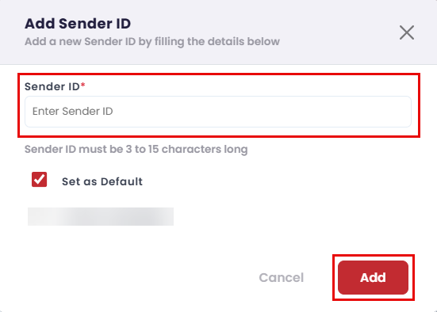
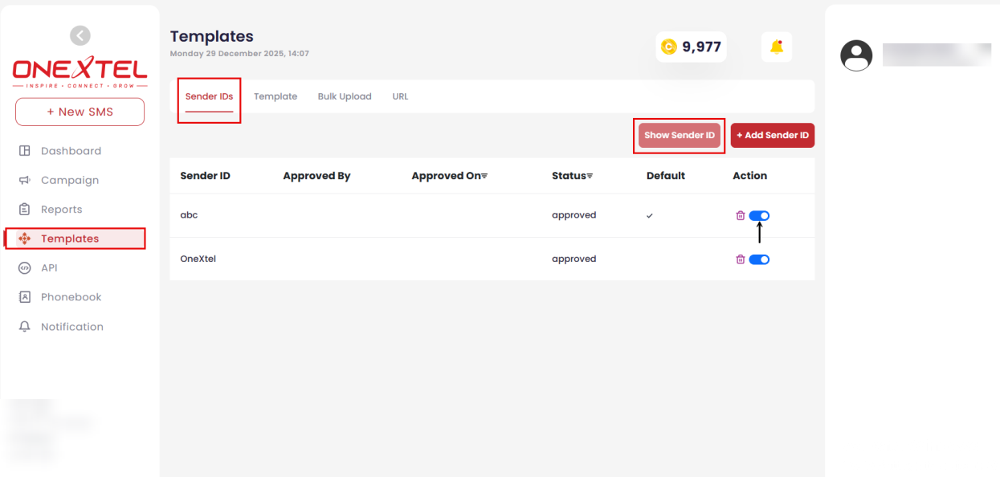

A sender ID is the name or number recipients see as the origin of your message, so they recognise your brand or service. The portal uses it to route and deliver messages. An approved sender ID keeps you compliant and prevents messages from being rejected.

Sender IDs live under **Templates**, on the **Sender IDs** tab.

## Add a sender ID

<Steps>
  <Step title="Open the Sender IDs tab">
    In the left pane, click **Templates**, then click the **Sender IDs** tab.
  </Step>
  <Step title="Add a sender ID">
    Click **+Add Sender ID**.
  </Step>
  <Step title="Enter the sender ID">
    In the pop-up, enter the **Sender ID**. It must be 3 to 15 characters long.
  </Step>
  <Step title="Set it as default">
    Select **Set as Default** to make this the default sender ID for your templates.
  </Step>
  <Step title="Save">
    Click **Add**. The portal adds the sender ID.
  </Step>
</Steps>

<Frame caption="Add Sender ID">
  
</Frame>

## View sender IDs

In the left pane, click **Templates**, click the **Sender IDs** tab, then click **Show Sender ID**. The portal lists your sender IDs with who approved them, when, their status, and whether each is the default.

<Frame caption="Sender ID list">
  
</Frame>

## Disable a sender ID

<Steps>
  <Step title="Open the sender ID list">
    In the left pane, click **Templates**, click the **Sender IDs** tab, then click **Show Sender ID**.
  </Step>
  <Step title="Turn it off">
    In the **Action** column, switch off the toggle for the sender ID.
  </Step>
</Steps>

<Frame caption="Disable a sender ID">
  
</Frame>

## Delete a sender ID

<Steps>
  <Step title="Open the sender ID list">
    In the left pane, click **Templates**, click the **Sender IDs** tab, then click **Show Sender ID**.
  </Step>
  <Step title="Delete">
    In the **Action** column, click the **Delete** icon.
  </Step>
</Steps>

## Related

- [Templates](/guides/sms-international/templates)
- [Sender ID Summary report](/guides/sms-international/reports#sender-id-summary)
