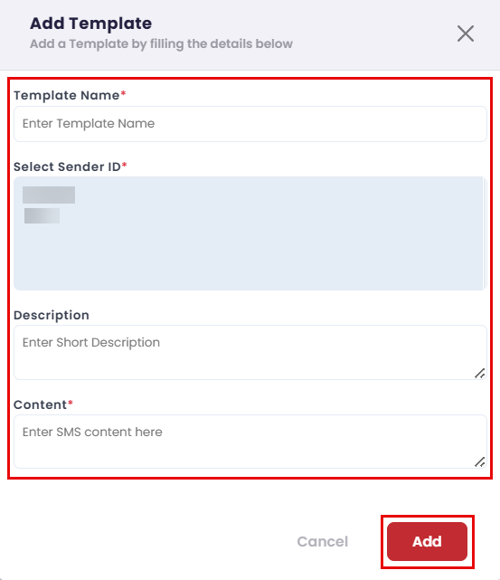
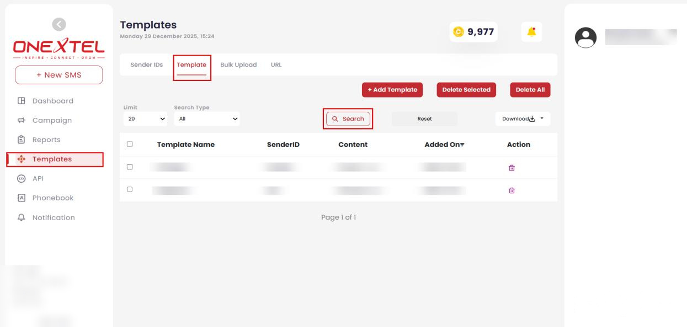
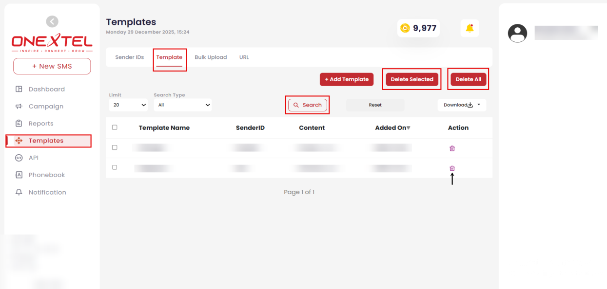

A template stores approved message content: fixed text plus placeholders for values that change per recipient. Templates keep your messages consistent and compliant, and let you insert content in one click when you [send SMS](/guides/sms-international/send-sms#insert-a-template).

Templates live under **Templates**, on the **Template** tab. Add a [sender ID](/guides/sms-international/sender-ids) first, because each template is linked to one.

## Add a template

<Steps>
  <Step title="Open the Template tab">
    In the left pane, click **Templates**, then click the **Template** tab.
  </Step>
  <Step title="Add a template">
    Click **+Add Template**.
  </Step>
  <Step title="Enter the template details">
    In the pop-up, enter the **Template Name**, select the **Sender ID**, and enter a **Description** and the SMS **Content**.
  </Step>
  <Step title="Save">
    Click **Add**. The portal adds the template.
  </Step>
</Steps>

<Frame caption="Add Template">
  
</Frame>

## View templates

In the left pane, click **Templates**, click the **Template** tab, then click **Search**. The portal lists your templates with their name, sender ID, content, and the date they were added.

<Frame caption="Template list">
  
</Frame>

## Delete templates

<Steps>
  <Step title="Open the template list">
    In the left pane, click **Templates**, click the **Template** tab, then click **Search**.
  </Step>
  <Step title="Delete">
    In the **Action** column, click the **Delete** icon for the template you want to delete. To delete several at once, select them and click **Delete Selected**, or click **Delete All**.
  </Step>
</Steps>

<Frame caption="Delete templates">
  
</Frame>

## Bulk upload

Upload many templates at once from a file.

<Steps>
  <Step title="Open the Bulk Upload tab">
    In the left pane, click **Templates**, then click the **Bulk Upload** tab.
  </Step>
  <Step title="Choose the file">
    Click **Choose File**, select the file, and click **Open**.
  </Step>
  <Step title="Save">
    Click **Save Template**. To clear the uploaded file instead, click **Reset**.
  </Step>
</Steps>

## Related

- [Sender IDs](/guides/sms-international/sender-ids)
- [Send SMS](/guides/sms-international/send-sms)
