The CleverTap connector adds RCS, SMS and WhatsApp as sendable channels inside CleverTap. Campaigns are built
and triggered in CleverTap; a stateless middleware service translates each send into OneXtel's
format and relays delivery reports, replies, and click events back.

Because the connector holds no database of its own — every routing decision comes from the
incoming request — OneXtel can run it as multiple parallel instances. You deploy nothing.

<Tip>
**Pick your channel once.** The sections below have an **RCS**, an **SMS** and a **WhatsApp** tab.
Choosing a tab in any section switches every section on the page to that channel. Jump straight
to [RCS](#setup-rcs), [SMS](#setup-sms) or [WhatsApp](#setup-whatsapp) setup.
</Tip>

## What it handles

<CardGroup cols={2}>
  <Card title="Outbound RCS" icon="paper-plane" href="#setup-rcs">
    RCS sends from CleverTap campaigns, using either CleverTap's composer output or a pre-made
    OneXtel template.
  </Card>
  <Card title="Outbound SMS" icon="message" href="#setup-sms">
    DLT-registered SMS from CleverTap's Generic SMS provider, with delivery reports mapped onto
    CleverTap's SMS error codes.
  </Card>
  <Card title="SMS fallback" icon="shuffle" href="#setup-rcs">
    If RCS delivery fails, OneXtel retries automatically over SMS using a DLT-approved template.
  </Card>
  <Card title="Delivery and clicks" icon="circle-check">
    Delivery reports, suggestion-button replies, and URL-click events relayed into CleverTap.
  </Card>
  <Card title="Inbound replies" icon="reply">
    Free-form RCS replies — text, media, location, contact — routed back to CleverTap.
  </Card>
  <Card title="Outbound WhatsApp" icon="whatsapp" href="#setup-whatsapp">
    Native WhatsApp template and freeform messages through your OneXtel WABA, with your approved
    templates imported into CleverTap.
  </Card>
  <Card title="WhatsApp fallback" icon="shuffle" href="#whatsapp-fallback">
    A WhatsApp message that cannot be delivered is retried over RCS or SMS, in the order your
    OneXtel Fallback ID sets.
  </Card>
</CardGroup>

## Before you start

Have these ready:

- **Your OneXtel API key** — see [API keys](/guides/platform/api-keys).
- **CleverTap access** to **Settings → Channels → SMS** (RCS and SMS) or **Settings → Channels →
  WhatsApp**, with permission to add a provider.
- **OneXtel access** to [callback configuration](/guides/platform/callback-configuration).
- **For SMS:** a DLT-registered sender ID, DLT entity ID, and DLT templates in OneXtel. See
  [DLT registration](/guides/sms/dlt).
- **For WhatsApp:** a WABA registered with OneXtel, its business phone number and WABA ID, and
  approved WhatsApp templates. The same API key must own the WhatsApp sender, any fallback
  senders, and every callback.
- **For WhatsApp fallback:** a Fallback ID from the OneXtel portal — see
  [Configure fallback](/guides/omnichannel/configure-fallback) — plus an RCS sender and template,
  or a DLT-registered SMS sender and template.

### Connector endpoints

Every URL for this connector sits on one host, WhatsApp included. Copy them from here as you go.
A WhatsApp campaign's RCS and SMS fallback reports use the RCS and SMS delivery routes.

| Channel | Purpose | URL |
| --- | --- | --- |
| RCS | RCS send | `https://ct.onex-aura.com/rcs/send` |
| RCS | Delivery reports and button replies | `https://ct.onex-aura.com/dlr` |
| RCS | Inbound messages | `https://ct.onex-aura.com/inbound` |
| RCS | URL clicks | `https://ct.onex-aura.com/click` |
| SMS | SMS send | `https://ct.onex-aura.com/sms/send` |
| SMS | SMS delivery reports — standalone SMS and RCS fallback alike | `https://ct.onex-aura.com/delivery` |
| WhatsApp | WhatsApp send | `https://ct.onex-aura.com/whatsapp/send` |
| WhatsApp | Template import | `https://ct.onex-aura.com/whatsapp/templates` |
| WhatsApp | Delivery reports | `https://ct.onex-aura.com/whatsapp/dlr` |
| WhatsApp | Inbound replies | `https://ct.onex-aura.com/whatsapp/inbound` |
| WhatsApp | URL clicks | `https://ct.onex-aura.com/whatsapp/click` |
| — | Health check | `https://ct.onex-aura.com/health` |

<Warning>
**The host is `onex-aura.com`, with a hyphen.** Dropping it gives you `ct.onexaura.com`, which
resolves to a real server that does not run the connector — so the mistake shows up as a timeout
or a silent failure rather than an obvious DNS error. Check the hyphen before you save anything.
</Warning>

## Set up

<Tabs>
<Tab title="RCS" id="setup-rcs">

Work through the parts in order.

| Part | What you do | Where |
| --- | --- | --- |
| [A](#part-a-—-create-the-provider-and-configure-rcs-and-sms-fallback) | Create the provider and configure RCS and SMS fallback | CleverTap |
| [B](#part-b-—-add-templates-in-clevertap-optional) | Add templates — **optional** | CleverTap |
| [C](#part-c-—-build-the-campaign-and-personalize-it) | Build the campaign and set up personalization | CleverTap |
| [D](#part-d-—-configure-the-callbacks-before-you-send) | Configure the callbacks | OneXtel |
| [E](#part-e-—-send-and-validate) | Send to a test audience, validate, then go live | Both |

### Part A — Create the provider and configure RCS and SMS fallback

<Steps>
  <Step title="Create the provider">
    In CleverTap, go to **Settings → Channels → SMS**, add a provider, and set **Provider** to
    **Generic RCS Provider**. Give it a clear nickname.
  </Step>

  <Step title="Set the messaging endpoint">
    | Field | Value |
    | --- | --- |
    | Request Type | `POST` |
    | HTTPS Endpoint | `https://ct.onex-aura.com/rcs/send` |
    | Authentication | No Authentication |
    | Headers | Key `apikey` → your OneXtel API key |

    Authentication is set to none because the API key travels as a header, not as an auth
    scheme CleverTap manages.

    <Frame caption="Provider Configuration — provider, messaging endpoint, and the apikey header">
      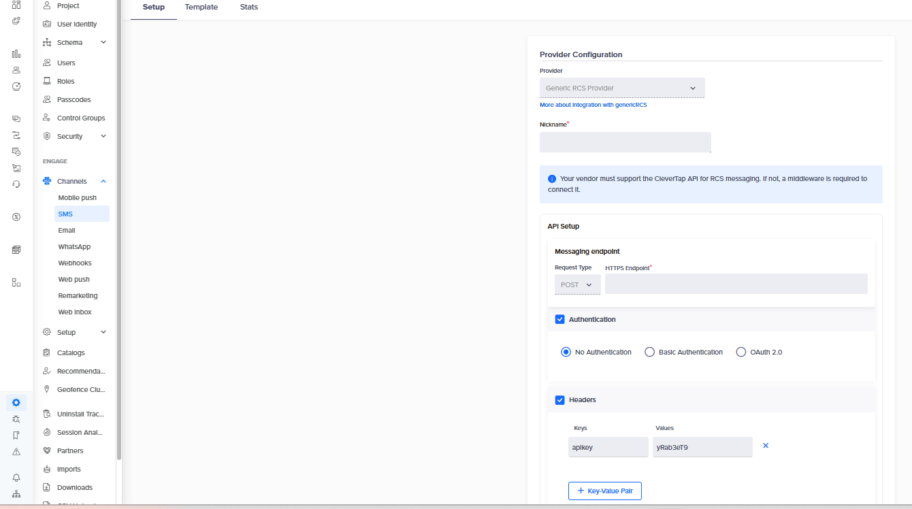
    </Frame>
  </Step>

  <Step title="Set the RCS sender and body parameters">
    Set **RCS Sender ID** to your OneXtel RCS sender profile, or to a
    [pool](/plugins/overview#pools-instead-of-a-single-sender). If you use a pool, only
    templates assigned to that pool will resolve. If your account has more than one sender
    profile, you can also choose the profile per campaign with an optional `sender_id` pair —
    see [Part C](#part-c-—-build-the-campaign-and-personalize-it).

    <Note>
    **Sending from several senders through one provider.** CleverTap fixes the RCS Sender ID on
    the provider, not on the campaign, so by default one provider sends from one profile. If you
    run several brands or senders on one CleverTap project, put a placeholder of the form
    `<brand>_onextel_rcs` in **RCS Sender ID** instead of a real profile — for example
    `acme_onextel_rcs`.

    OneXtel reads any sender ID in that shape as a placeholder rather than a real sender, and
    takes the actual profile from the `sender_id` key-value pair on each campaign. That pair
    stops being optional and becomes required: a campaign that omits it is rejected rather than
    sent from the placeholder.

    The same applies to SMS, with `<brand>_onextel_sms` and the SMS provider's **Sender ID**.
    One provider and one endpoint then serve every sender on the account.
    </Note>

    Under **RCS Body Parameters**, add these key-value pairs. The `$$` syntax tells CleverTap to
    fill the value from the campaign's custom params.

    | Key | Value |
    | --- | --- |
    | `message_type` | `$$message_type` |
    | `template_id` | `$$template_id` |

    <Frame caption="RCS Config — sender ID and body parameters">
      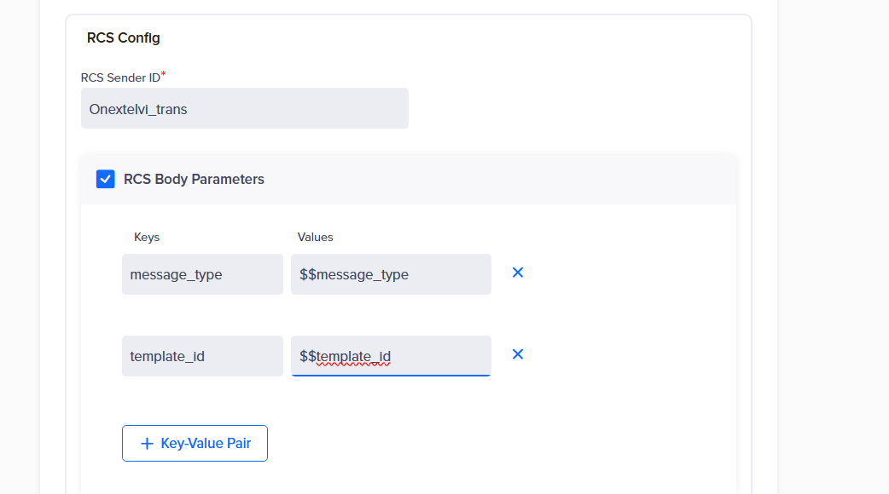
    </Frame>
  </Step>

  <Step title="Enable SMS fallback">
    Turn on **SMS Configuration / Enable Fallback SMS** and set **SMS Sender ID** to your
    OneXtel SMS sender ID.

    Under **SMS Body Parameters**, add:

    | Key | Value |
    | --- | --- |
    | `type` | `$$type` |
    | `templateId` | `$$templateId` |
    | `unicode` | `$$unicode` |
    | `entityId` | `$$entityId` |
    | `fallback_id` | `$$fallback_id` |

    <Frame caption="SMS Configuration — fallback sender and body parameters">
      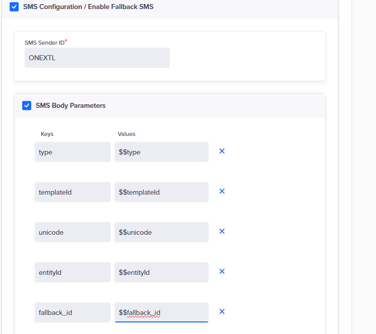
    </Frame>
  </Step>

  <Step title="Save, then copy both callback URLs">
    Save the provider, then **reopen it**. Under **Callback Config** you will find two
    read-only URLs. Copy both — you paste them into OneXtel in
    [Part D](#part-d-—-configure-the-callbacks-before-you-send).

    | URL | Used for |
    | --- | --- |
    | Delivery Report Callback URL | Delivery reports, clicks, and SMS fallback reports |
    | Inbound Message Callback URL | Inbound replies — carries a `providerId` parameter |

    The Inbound URL only appears after you reopen the saved provider; immediately after the
    first save you may see only the Delivery Report URL.
  </Step>
</Steps>

### Part B — Add templates in CleverTap (optional)

You do not need a CleverTap template to send a OneXtel template. The `template_id` key-value pair
you add to the campaign in [Part C](#part-c-—-build-the-campaign-and-personalize-it) tells OneXtel
which approved template to send, and the campaign's other key-value pairs fill its variables. A
**Text Free Form** campaign with the right pairs is enough.

Add templates here only when you want to build campaigns from them inside CleverTap — for
example, to start from a prebuilt card or carousel layout in the campaign composer.

To add one, open the saved provider, switch to its **Templates** tab, and create the template
with the **exact same name** as its OneXtel template code — for example `payment_success_onex` —
and the same type (Text, Rich Card or Carousel). Template names are unique per provider, so the
same name can be reused across a UAT and a production provider.

CleverTap documents this in
[Generic RCS → Add a Template](https://docs.clevertap.com/docs/generic-rcs#add-a-template)
and, for the fields of each template type, in
[RCS Message Templates](https://docs.clevertap.com/docs/rcs-message-templates#add-message-template).

<Warning>
**Do not use CleverTap's `{{1}}` placeholders to personalize.** CleverTap's template editor
recommends positional variables such as `{{1}}` and `{{2}}`, but their values are not passed to
OneXtel. If a template you add here contains them, CleverTap still asks for a value before it
lets you publish — fill it with anything. What the recipient sees comes from the campaign's
key-value pairs, set up in Part C.
</Warning>

### Part C — Build the campaign and personalize it

Everything OneXtel needs to render the message travels in the campaign's **RCS Body Key-Value
Pairs**: which template to send, its message category, and the value of each variable.

<Steps>
  <Step title="Create the campaign">
    In CleverTap, create a new campaign. Under **From**, select the provider you created in
    Part A. Under **Who**, choose your audience. Under **What**, choose the **Text Free Form**
    type and enter a message body — or, if you added templates in Part B, pick one of those.

    When the campaign sends a OneXtel template through `template_id`, the body you enter here is
    only what CleverTap shows while you build. The recipient receives the OneXtel template.
  </Step>

  <Step title="Add the RCS key-value pairs">
    | Key | Example | Notes |
    | --- | --- | --- |
    | `message_type` | `Transactional` | `Promotional` or `Transactional` |
    | `template_id` | `payment_success_onex` | The OneXtel template to send. Omit to send the composer output instead |
    | `sender_id` | `Acme_1` | **Optional** — only when your account has more than one sender profile. Names the profile to send from; omit it to use the provider's **RCS Sender ID**. **Required**, not optional, when the provider's RCS Sender ID is a `<brand>_onextel_rcs` placeholder. The `template_id` template must belong to this profile |
    | `custom_param1` | `@Profile - Name \| default: "Customer"` | One pair per template variable. The **key** is the placeholder name from the OneXtel template, without the square brackets. The **value** is a CleverTap personalization token |
    | any other key | — | Passed through to OneXtel as a template placeholder value |

    <Frame caption="Campaign composer — RCS body key-value pairs">
      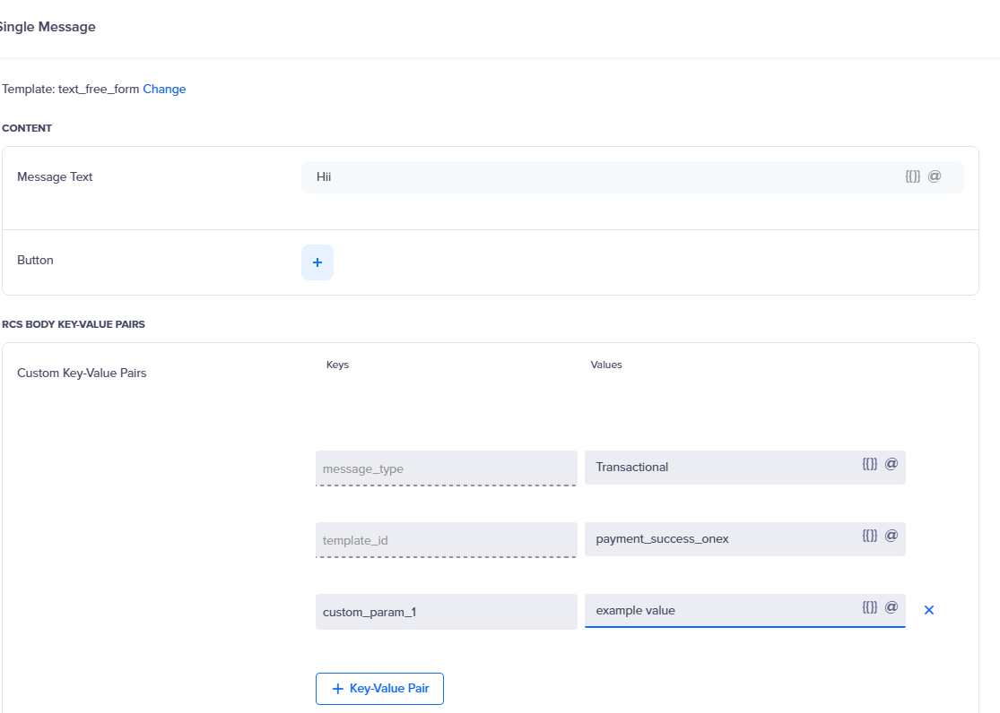
    </Frame>

    **To personalize a template variable**, add a key-value pair for it here, in the campaign's
    **What** section — not in the provider setup. Type `@` in the value field to open
    CleverTap's personalization menu, choose the user or event property, and set a default for
    recipients who do not have it. CleverTap resolves the token for each recipient at send time
    and the connector passes the resolved value to OneXtel under the same key.

    If the OneXtel template reads `Hi [custom_param1]`, the key is `custom_param1`. A key that
    does not match the bracketed name character for character leaves the placeholder unfilled
    on the handset.

    <Frame caption="Campaign composer — a personalized key-value pair for the template placeholder">
      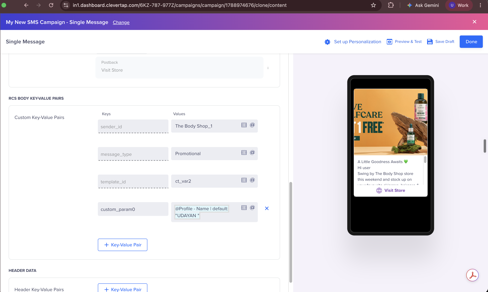
    </Frame>

    <Note>
    For the token syntax and defaults, see CleverTap's
    [RCS Message Editor](https://docs.clevertap.com/docs/rcs-message-editor) and
    [Personalize Message](https://docs.clevertap.com/docs/personalize-message-sms).
    </Note>
  </Step>

  <Step title="Add the fallback SMS block">
    Toggle on **Fallback SMS**, enter the fallback text, and add:

    | Key | Example | Notes |
    | --- | --- | --- |
    | `fallback_id` | `4f2005fa-…` | The fallback configuration ID from your OneXtel account |
    | `templateId` | Your DLT template ID | Required for Indian sends |
    | `entityId` | Your DLT entity ID | Required for Indian sends |
    | `type` | `SI` | Must match the DLT template's registered category |
    | `unicode` | `0` | `1` if the body contains non-ASCII characters |

    <Frame caption="Campaign composer — Fallback SMS block and its key-value pairs">
      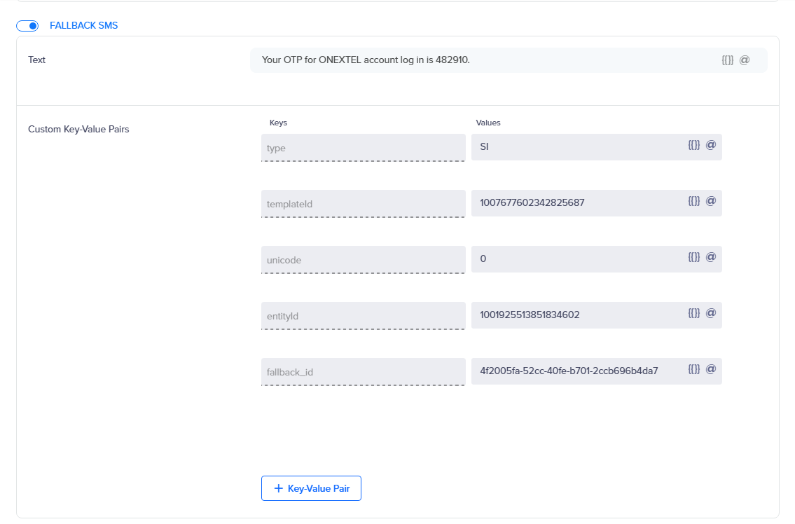
    </Frame>
  </Step>

  <Step title="Save the campaign as a draft">
    Save the campaign, but **do not publish it yet**. Set up the callbacks in Part D first, so
    the delivery reports, replies, and clicks from the very first send reach CleverTap.
  </Step>
</Steps>

<Warning>
**A fallback only fires if the SMS block is complete.** If `fallback_id`, `templateId`, or
`entityId` is missing or misnamed, the RCS send still goes out normally — but the fallback
silently lacks what OneXtel needs, and that failure is **not surfaced back to CleverTap as an
error**. Verify the fallback explicitly rather than assuming it works.
</Warning>

<Warning>
`type` values are narrower than earlier guides stated. Live testing accepts only `SI`, `OTP`,
and `SE` — `TXN`, `TRANS`, and `Promo` are rejected as `invalid type`. See
[Send SMS — India](/api-reference/sms/send-sms-omni).
</Warning>

### Part D — Configure the callbacks before you send

Before you publish, create **four** callbacks in OneXtel. They carry delivery reports, replies,
clicks, and fallback reports back to CleverTap. Each one needs a custom header named `callback`,
set to one of the two CleverTap URLs you copied at the end of Part A.

| Webhook | Channel | Type | Callback URL | `callback` header |
| --- | --- | --- | --- | --- |
| RCS DLR | RCS | Delivery Notification | `https://ct.onex-aura.com/dlr` | Delivery Report URL |
| Inbound | RCS | Incoming | `https://ct.onex-aura.com/inbound` | **Inbound Message URL** |
| URL Click | RCS | URL Click | `https://ct.onex-aura.com/click` | Delivery Report URL |
| SMS fallback DLR | SMS | Delivery Notification | `https://ct.onex-aura.com/delivery` | Delivery Report URL |

All four use **HTTP Method `POST`**.

<Warning>
**These are two different URLs, and swapping them is the most common setup error.** Pasting the
Delivery Report URL where the Inbound URL belongs causes CleverTap to reject the relay with
`providerId query parameter is required for replied events`.
</Warning>

<Note>
Two things that catch people out:

- RCS delivery reports and suggestion-button replies **share the `/dlr` webhook** — OneXtel
  sends both there.
- The SMS fallback report is a **genuinely separate webhook on the SMS channel**. Do not reuse
  the RCS DLR entry for it.
</Note>

See [Callback configuration](/guides/platform/callback-configuration) for how to add a callback
and its headers.

<Frame caption="RCS delivery notification webhook — Channel RCS, Type Delivery Notification, POST">
  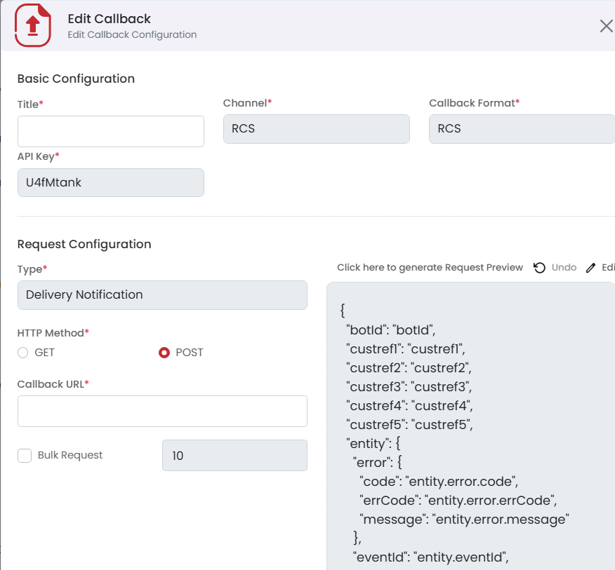
</Frame>

<Frame caption="Additional Configuration — the callback header carries the CleverTap URL">
  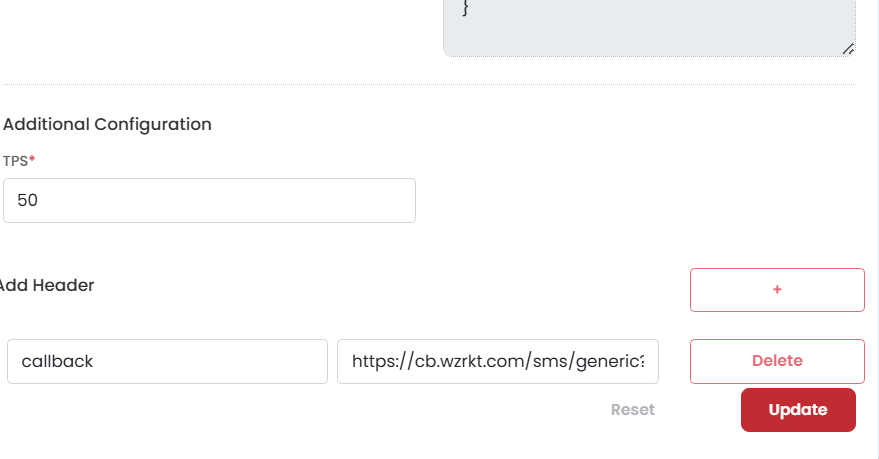
</Frame>

<Frame caption="Inbound webhook — Type Incoming">
  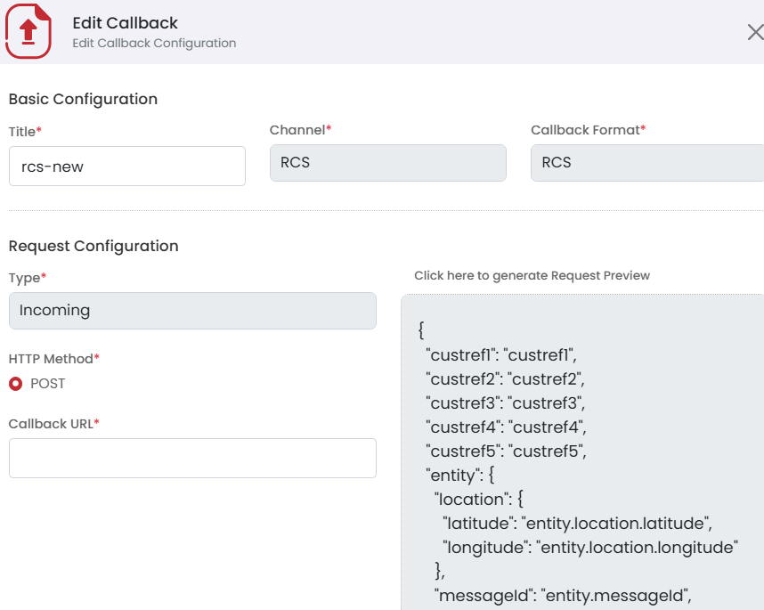
</Frame>

<Frame caption="URL click webhook — Type URL Click">
  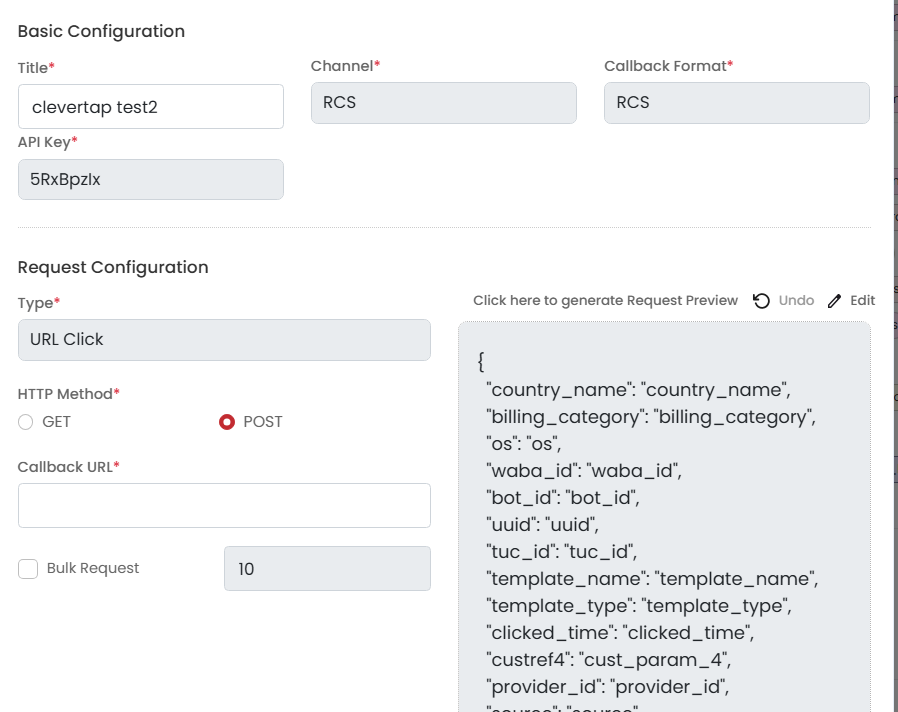
</Frame>

<Frame caption="SMS fallback webhook — note the channel is SMS, not RCS">
  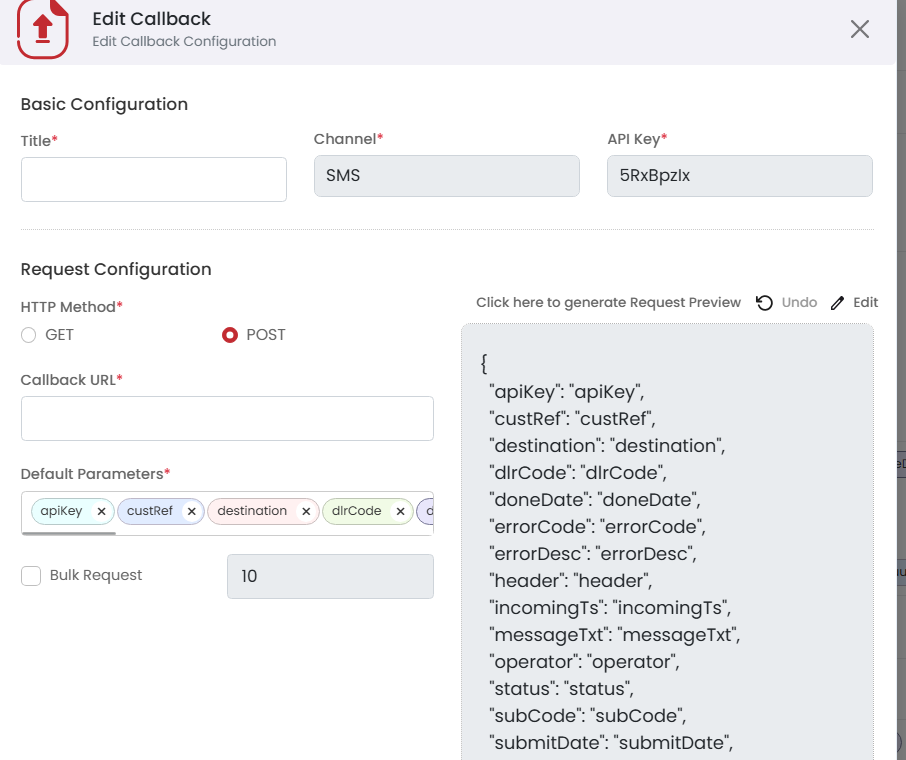
</Frame>

### Part E — Send and validate

Send to a small test audience first, and confirm each of these independently before sending to
everyone:

<Steps>
  <Step title="Publish to a test audience">
    Open the draft, choose the send time, review the summary, and publish it to test devices you
    control — including one number that is not RCS-capable, for the fallback check.
  </Step>
  <Step title="Confirm RCS delivery">
    A test send shows as Delivered in OneXtel reporting, and the same event appears in
    CleverTap's campaign stats.
  </Step>
  <Step title="Confirm inbound replies">
    A reply from a test device appears in CleverTap under **People**, in that profile's event
    timeline.
  </Step>
  <Step title="Confirm click tracking">
    A button or URL click on a template message reaches CleverTap.
  </Step>
  <Step title="Confirm SMS fallback">
    An RCS send to a genuinely non-RCS-capable number triggers the fallback, the SMS arrives,
    and its delivery status comes back through the `/delivery` webhook.
  </Step>
  <Step title="Go live">
    Once all four check out, send the campaign to your full audience.
  </Step>
</Steps>

### Personalize a template

Personalization happens in CleverTap, before the send reaches OneXtel, and it travels entirely in
the campaign's RCS key-value pairs. The connector does not substitute anything itself: it forwards
each campaign key-value pair to OneXtel as a template variable under the same key name, and
OneXtel fills the matching `[placeholder]` in the approved template. The step-by-step is in
[Part C](#part-c-—-build-the-campaign-and-personalize-it); this section is the reference.

| Key | Value | Example |
| --- | --- | --- |
| `template_id` | The OneXtel template code | `ct_var2` |
| `message_type` | `Promotional` or `Transactional` | `Promotional` |
| `sender_id` — optional | The OneXtel sender profile, only when the account has more than one | `Acme_1` |
| The placeholder name, without brackets | A CleverTap `@` personalization token, with a default | `custom_param0` set to `@Profile - Name \| default: "Customer"` |

<Warning>
**CleverTap's recommended method — positional `{{1}}` placeholders — does not personalize
OneXtel templates.** Their values are not passed to OneXtel. Use key-value pairs named after the
OneXtel placeholders instead. Creating a matching template in CleverTap is optional — see
[Part B](#part-b-—-add-templates-in-clevertap-optional).
</Warning>

When you create OneXtel templates for CleverTap, name the variables `[custom_param1]`,
`[custom_param2]` and so on. Any name is accepted, but one convention keeps campaigns
predictable. To check an existing template's variable names, open it in the OneXtel portal or
use [Fetch templates](/api-reference/rcs/templates#fetch-template).

What the connector sends to OneXtel for a `custom_param1` pair resolved to `Kabir Sethi`:

```json
{
  "templateMessage": {
    "templateCode": "ct_var1",
    "customParams": "{\"custom_param1\":\"Kabir Sethi\"}"
  }
}
```

<Warning>
**Provider-level parameters are not personalized per user.** A key added under
**RCS Body Parameters** in the provider setup (Part A) takes one value per campaign. Per-user
values must come from a key-value pair added on the campaign itself, in the **What** section.
</Warning>

For CleverTap's own guidance on personalization tokens, defaults, and Liquid expressions, see
[RCS Message Editor](https://docs.clevertap.com/docs/rcs-message-editor),
[Personalize Message](https://docs.clevertap.com/docs/personalize-message-sms), and
[Liquid Tags](https://docs.clevertap.com/docs/liquid-tags) in the CleverTap documentation.

### Buttons and templates

CleverTap's composer cannot reference a saved OneXtel template by ID directly. To send one, use
the `template_id` custom parameter — every other custom param on that campaign is then passed
through as a placeholder value.

<Note>
This is currently the only reliable way to get a working URL-action or dial-action button.
Ad-hoc, non-template cards reliably support only a plain Reply button.
</Note>

</Tab>
<Tab title="SMS" id="setup-sms">

Standalone SMS uses its own CleverTap provider — a **Generic SMS Provider** — separate from the
RCS provider and from the fallback SMS block inside it. A project can run both.

| Part | What you do | Where |
| --- | --- | --- |
| [A](#part-a-—-create-the-generic-sms-provider) | Create the SMS provider and its request body | CleverTap |
| [B](#part-b-—-configure-the-sms-callbacks) | Configure the delivery callback | OneXtel |
| [C](#part-c-—-build-the-sms-campaign) | Build the campaign | CleverTap |
| [D](#part-d-—-send-a-test-sms-and-go-live) | Send to a test audience, then go live | Both |

### Part A — Create the Generic SMS provider

<Steps>
  <Step title="Create the provider">
    In CleverTap, go to **Settings → Channels → SMS**, add a provider, and set **Provider** to
    **Generic SMS Provider**. Give it a clear nickname — it is what you pick in the campaign
    composer.
  </Step>

  <Step title="Set the messaging endpoint">
    | Field | Value |
    | --- | --- |
    | Request Type | `POST`, with a **JSON** body |
    | HTTPS Endpoint | `https://ct.onex-aura.com/sms/send` |
    | Authentication | No Authentication |
    | Headers | Key `apikey` → your OneXtel API key |

    As with RCS, the API key travels as a header rather than an auth scheme CleverTap manages.
  </Step>

  <Step title="Set the request body">
    Paste this into the provider's parameters JSON, then replace the last three values with your
    own:

    ```json
    {
      "to": "$$To",
      "body": "$$Body",
      "templateId": "$$TemplateID",
      "msgId": "$$MessageID",
      "campaignId": "$$CampaignID",
      "senderId": "YOUR_SENDER_ID",
      "entityId": "YOUR_DLT_ENTITY_ID",
      "type": "SI"
    }
    ```

    The `$$` values are CleverTap's own macros and stay exactly as written — CleverTap fills them
    for each recipient at send time.

    | Key | Value | Notes |
    | --- | --- | --- |
    | `to` | `$$To` | Recipient number |
    | `body` | `$$Body` | Message text. Must match the DLT template word for word |
    | `templateId` | `$$TemplateID` | The DLT template ID, set per campaign |
    | `msgId` | `$$MessageID` | **Required.** CleverTap matches each delivery report to its message by this value |
    | `campaignId` | `$$CampaignID` | Passed to OneXtel as the campaign name, for reporting |
    | `senderId` | Your DLT sender ID | For example `ONEXTL` |
    | `entityId` | Your DLT entity ID | The principal entity ID the templates are registered under |
    | `type` | `SI`, `OTP` or `SE` | The DLT category the template is registered under. Case-sensitive; defaults to `SI` if left out |
    | `unicode` | `1` | **Optional.** Add it for bodies with non-ASCII characters. Any value other than `0` or `1` is ignored |
    | `urlTracking` | `1` | **Optional.** Turns link shortening ON. Leave it out and your links are sent untouched — see below |

    <Warning>
    **Key names are exact.** A misspelled key — `templateID` instead of `templateId`, say — is
    dropped without an error, and the SMS goes out without it. Keep the quotes around every value
    too: a long ID sent as a bare number loses digits before it arrives.
    </Warning>

    To choose a value per campaign instead of fixing it here, make it a CleverTap custom
    replacement — for example `"senderId": "$$senderId"`. CleverTap then asks for it as a
    required field on every campaign that uses this provider.

    <Note>
    **Link shortening is off by default.** Your links are sent exactly as written unless you ask
    for shortening. Add `"urlTracking": "1"` to the parameters JSON to turn it on: every link in
    the message body is then rewritten to a OneXtel short link, and the taps are counted in
    OneXtel's Clicker Data and Clicker Details reports.

    **Those taps stay in OneXtel.** SMS clicks are not sent back to CleverTap — the `/click`
    webhook above carries RCS URL clicks only, so turning this on will not populate click metrics
    on your CleverTap SMS campaign. If you want SMS clicks in CleverTap, use CleverTap's own link
    tracking instead, and leave `urlTracking` off so the link is not rewritten a second time.

    Shortening is opt-in because the rewrite has consequences under DLT — once it is on, the
    OneXtel short domain has to be whitelisted on the DLT template in place of your own link's
    domain, so switching it on without updating the template registration gets the message
    rejected at scrubbing.

    Values `1`, `true`, `yes` and `on` turn it on; anything else, including a missing or
    misspelled value, leaves your links untouched.
    </Note>
  </Step>

  <Step title="Save, then copy the callback URL">
    Save the provider, then **reopen it** and copy the **Delivery Report Callback URL** under
    **Callback Config**. You paste it into OneXtel in
    [Part B](#part-b-—-configure-the-sms-callbacks).
  </Step>
</Steps>

### Part B — Configure the SMS callbacks

In OneXtel, go to **Configuration → Add New Callback** and add the SMS delivery callback against
the **same API key** you put on the provider:

| Field | Value |
| --- | --- |
| Channel | `SMS` |
| Type | `Delivery Notification` |
| HTTP Method | `POST` |
| Callback URL | `https://ct.onex-aura.com/delivery` |
| Header | Key `callback`, value = the Delivery Report Callback URL from Part A |
| Callback Format | Default |

<Warning>
**The `callback` header is required.** It tells the connector which CleverTap account the report
belongs to. A report that arrives without it is rejected with code `2004` and never reaches
CleverTap. Never save a callback with an empty header row either — OneXtel then sends a header
with no name, which the connector's web server refuses.
</Warning>

If you also run RCS with SMS fallback on the same API key, this is the same callback as the RCS
tab's **SMS fallback DLR** — one SMS delivery callback serves both.

### Part C — Build the SMS campaign

<Steps>
  <Step title="Create the campaign">
    In CleverTap, create an SMS campaign. Under **From**, select the Generic SMS provider from
    Part A, and choose your audience under **Who**.
  </Step>
  <Step title="Write the message and set the DLT template ID">
    Under **What**, enter the message exactly as registered on DLT, with personalization where
    the template has variables, and set the DLT template ID CleverTap passes as `$$TemplateID`.
    Fill any custom replacements you added to the provider body.
  </Step>
  <Step title="Save the campaign as a draft">
    Save it, but do not publish until the Part B callback is in place — otherwise the delivery
    reports from the first send never reach CleverTap.
  </Step>
</Steps>

### Part D — Send a test SMS and go live

<Steps>
  <Step title="Publish to a test audience">
    Send to test devices you control.
  </Step>
  <Step title="Confirm the send was accepted">
    A send OneXtel refuses comes back in the provider's reply with code `900` and OneXtel's own
    reason, rather than as a delivery report — see [Error code mapping](#error-code-mapping).
  </Step>
  <Step title="Confirm delivery">
    The SMS arrives, shows as Delivered in OneXtel reporting, and the same event appears in
    CleverTap's campaign stats.
  </Step>
  <Step title="Go live">
    Once both check out, send the campaign to your full audience.
  </Step>
</Steps>

<Note>
CleverTap's **Preview & Test** sends all share one placeholder message ID, so their delivery
reports cannot be matched one-to-one. Judge delivery tracking from a real test campaign.
</Note>

</Tab>
<Tab title="WhatsApp" id="setup-whatsapp">

WhatsApp uses its own CleverTap provider — a **Generic WhatsApp** provider — separate from the RCS
and SMS providers. The recipient gets a native WhatsApp message from your registered business
number. If you add a fallback, OneXtel sends the same message over RCS, SMS, or both when the
WhatsApp message fails or is not delivered in time.

| Part | What you do | Where |
| --- | --- | --- |
| [A](#part-a-—-create-the-generic-whatsapp-provider) | Create the Generic WhatsApp provider | CleverTap |
| [B](#part-b-—-import-your-whatsapp-templates) | Import your approved templates | CleverTap |
| [C](#part-c-—-configure-the-whatsapp-callbacks) | Configure the callbacks | OneXtel |
| [D](#part-d-—-build-the-whatsapp-campaign) | Build the campaign, with or without fallback | CleverTap |
| [E](#part-e-—-send-a-test-whatsapp-and-go-live) | Send to a test audience, validate, then go live | Both |

### Part A — Create the Generic WhatsApp provider

<Steps>
  <Step title="Create the provider">
    In CleverTap, go to **Settings → Channels → WhatsApp**, add a provider, and choose
    **Generic WhatsApp**. There is no OneXtel-specific entry in CleverTap's list; the generic
    provider pointed at the connector is the integration.
  </Step>

  <Step title="Set the messaging endpoint">
    | Field | Value |
    | --- | --- |
    | Request Type | `POST` |
    | HTTPS Endpoint | `https://ct.onex-aura.com/whatsapp/send` |
    | Authentication | No Authentication |
    | Headers | Key `apikey` → your OneXtel API key |
    | WABA number | Your WhatsApp business **phone number** with country code |

    <Warning>
    **Enter the business phone number, not the WABA ID.** OneXtel identifies the WhatsApp
    account from the number. A WABA ID in this field is refused on every send as an invalid
    sender.
    </Warning>
  </Step>

  <Step title="Save the provider">
    When you save, CleverTap sends a validation request to the endpoint. The connector answers it
    directly and sends no message, so saving costs nothing and reaches no one.
  </Step>

  <Step title="Copy the callback URLs">
    Reopen the saved provider and copy the URLs under **Callback Config**. You paste them into
    OneXtel in [Part C](#part-c-—-configure-the-whatsapp-callbacks).

    | URL | Used for |
    | --- | --- |
    | Delivery Report Callback URL | Delivery reports, clicks, and fallback outcomes |
    | Inbound Message Callback URL | Customer replies |
  </Step>
</Steps>

### Part B — Import your WhatsApp templates

CleverTap can pull your approved WhatsApp templates from the connector, so campaign builders pick
from the same list OneXtel will send. In the provider's template import settings, enter:

| Field | Value |
| --- | --- |
| Method | `GET` |
| URL | `https://ct.onex-aura.com/whatsapp/templates` |
| Header | Key `apikey` → your OneXtel API key |
| Header | Key `wabaid` → your WABA ID |

Only **approved** templates are returned, 50 per page by default. The connector pages through the
full list for CleverTap, and you can import again whenever new templates are approved.

If the import fails, CleverTap shows an error rather than an empty list: a missing `wabaid` header
is refused with HTTP 400, and a failure on the OneXtel side with HTTP 502. An empty, successful
import means the WABA has no approved templates under that key.

### Part C — Configure the WhatsApp callbacks

Create these callbacks in OneXtel **on the same API key** as the provider. Each needs a custom
header named `callback`, set to one of the CleverTap URLs you copied in Part A. All use **HTTP
Method `POST`**.

| Webhook | Channel | Type | Callback URL | `callback` header |
| --- | --- | --- | --- | --- |
| WhatsApp DLR | WhatsApp | Delivery Notification | `https://ct.onex-aura.com/whatsapp/dlr` | Delivery Report URL |
| WhatsApp inbound | WhatsApp | Incoming | `https://ct.onex-aura.com/whatsapp/inbound` | **Inbound Message URL** |
| WhatsApp URL click | WhatsApp | URL Click | `https://ct.onex-aura.com/whatsapp/click` | Delivery Report URL |

**If you use fallback**, OneXtel reports the fallback message on the RCS or SMS delivery callback,
not the WhatsApp one. Make sure these also exist on the same API key:

| Webhook | Channel | Type | Callback URL | `callback` header |
| --- | --- | --- | --- | --- |
| RCS fallback DLR | RCS | Delivery Notification | `https://ct.onex-aura.com/dlr` | Delivery Report URL |
| SMS fallback DLR | SMS | Delivery Notification | `https://ct.onex-aura.com/delivery` | Delivery Report URL |

If you already created these for an RCS or SMS provider on the same key — see the RCS tab's
[Part D](#part-d-—-configure-the-callbacks-before-you-send) and the SMS tab's
[Part B](#part-b-—-configure-the-sms-callbacks) — keep them as they are; one callback per
channel serves both. The connector recognises a WhatsApp campaign's fallback
report and records it against the original WhatsApp message in CleverTap.

<Warning>
**A missing callback fails silently.** A report that arrives without the `callback` header is
rejected with code `2004` and never reaches CleverTap. A fallback whose RCS or SMS delivery
callback sits on a different API key never reports its outcome at all. Never save a callback with
an empty header row either — OneXtel then sends a header with no name, which the connector's web
server refuses.
</Warning>

See [Callback configuration](/guides/platform/callback-configuration) for how to add a callback
and its headers.

### Part D — Build the WhatsApp campaign

<Steps>
  <Step title="Create the campaign">
    In CleverTap, create a WhatsApp campaign. Under **From**, select the provider from Part A,
    and choose your audience under **Who**.
  </Step>

  <Step title="Choose the message">
    Under **What**, pick an imported template and fill its variables, media, and button values.
    CleverTap sends them in template order, and the connector passes them to OneXtel in that same
    order.

    To send a freeform message instead, choose a non-template message. Freeform messages reach
    only recipients who messaged your business number in the last 24 hours — outside that window,
    WhatsApp fails the message.
  </Step>

  <Step title="Add fallback, if you want it">
    Add the fallback keys below as the campaign's custom key-value pairs. Leave them all out for
    a WhatsApp-only campaign. See [Fallback](#whatsapp-fallback) for what each key does.
  </Step>

  <Step title="Save the campaign as a draft">
    Save it, but do not publish until the Part C callbacks are in place — otherwise reports from
    the first send never reach CleverTap.
  </Step>
</Steps>

### Part E — Send a test WhatsApp and go live

<Steps>
  <Step title="Publish to a test audience">
    Send to test devices you control. For a fallback check, include a number that is not on
    WhatsApp.
  </Step>
  <Step title="Confirm the send was accepted">
    A refused send comes back in the provider's reply with a code and a reason — see
    [Send responses](#errors-whatsapp).
  </Step>
  <Step title="Confirm delivery">
    The message arrives on WhatsApp, and sent, delivered, and read appear in CleverTap's campaign
    stats.
  </Step>
  <Step title="Confirm replies">
    A reply from a test device appears in CleverTap in that profile's event timeline.
  </Step>
  <Step title="Confirm fallback">
    The send to the non-WhatsApp number fails on WhatsApp, the RCS or SMS message arrives, and
    the outcome appears on the same message in CleverTap.
  </Step>
  <Step title="Go live">
    Once each check passes, send the campaign to your full audience.
  </Step>
</Steps>

### WhatsApp fallback

A fallback has two halves, and you set them in different places:

- **The Fallback ID**, created in the OneXtel portal, holds the **channel order** — RCS first,
  SMS first, or one channel only. See [Configure fallback](/guides/omnichannel/configure-fallback).
- **The campaign's key-value pairs** carry the **content** for each fallback channel: which sender
  and template to use, and the SMS text.

OneXtel sends the fallback when the WhatsApp message fails, or when no delivered or failed status
arrives within the wait time. A WhatsApp message that is delivered does not fall back. See
[Fallback overview](/guides/omnichannel/fallback-overview).

The `fallback_id` key is the switch. Without it, every other fallback key is ignored and the
campaign sends WhatsApp only.

#### Fallback keys

| Key | Required | Notes |
| --- | --- | --- |
| `fallback_id` | For any fallback | The Fallback ID from the OneXtel portal |
| `fallback_waittime` | No | Seconds to wait for a WhatsApp status before falling back. Default `30` |
| `fallback_rcs_sender` | For an RCS leg | Your OneXtel RCS sender profile — a name, not a phone number |
| `fallback_rcs_template` | For an RCS leg | The OneXtel RCS template code to send |
| `fallback_rcs_message_type` | No | `Promotional` or `Transactional`. Default `Promotional` |
| `fallback_sms_sender` | For an SMS leg | Your DLT sender ID, for example `ONEXTL` |
| `fallback_sms_body` | For an SMS leg | The SMS text. Must match the DLT template word for word |
| `fallback_sms_templateId` | With `fallback_sms_entityId` | The DLT template ID |
| `fallback_sms_entityId` | With `fallback_sms_templateId` | Your DLT entity ID |
| `fallback_sms_type` | No | The DLT category. Default `SI` |

Set the RCS keys, the SMS keys, or both. With both, the Fallback ID's channel order decides which
leg OneXtel tries first.

<Warning>
**Check the Fallback ID character for character.** OneXtel accepts an unknown Fallback ID without
an error, and the campaign then goes out as WhatsApp only. Nothing in CleverTap shows that the
fallback is missing — confirm it with a test send to a number that is not on WhatsApp.
</Warning>

**Example — WhatsApp with RCS fallback:**

| Key | Value |
| --- | --- |
| `fallback_id` | `4f2005fa-…` |
| `fallback_rcs_sender` | `Acme_1` |
| `fallback_rcs_template` | `order_update_rcs` |
| `fallback_rcs_message_type` | `Transactional` |
| `fallback_waittime` | `60` |

**Example — WhatsApp with SMS fallback:**

| Key | Value |
| --- | --- |
| `fallback_id` | `4f2005fa-…` |
| `fallback_sms_sender` | `ONEXTL` |
| `fallback_sms_body` | Your DLT-approved text |
| `fallback_sms_templateId` | Your DLT template ID |
| `fallback_sms_entityId` | Your DLT entity ID |
| `fallback_sms_type` | `SI` |

#### Name the RCS fallback template's variables

WhatsApp variables are numbered by position; OneXtel RCS templates fill `[placeholder]` names. The
connector bridges the two with fixed names, so **the RCS fallback template must use exactly these
placeholders**:

| RCS placeholder | Filled from |
| --- | --- |
| `[var1]`, `[var2]`, … | WhatsApp body variables `{{1}}`, `{{2}}`, …, in order |
| `[header_var1]` | The WhatsApp text header's variable |
| `[media_url]` | The WhatsApp media header's URL |
| `[button0_url]`, `[button1_url]`, … | A dynamic URL button's value, by the button's zero-based position in the template |

A placeholder with any other name is left unfilled on the handset, and the send still succeeds —
so the fallback fires but the message reads wrong.

#### The SMS leg carries its own text

The SMS fallback does not reuse the WhatsApp template's text. It sends `fallback_sms_body`
exactly as you enter it, so every recipient of the campaign gets the same SMS.

Send `fallback_sms_templateId` and `fallback_sms_entityId` together, or leave both out when your
API key has DLT template auto-match enabled. A send with only one of the two is refused.

#### What a fallback campaign cannot contain

A fallback must be renderable on RCS or SMS, so some WhatsApp content is refused when a
`fallback_id` is present. The send is answered with code `2001` and a reason naming the
component:

- **Carousel templates with an RCS fallback.** RCS has no equivalent for the cards.
- **Location headers or location parameters**, and **product headers**.
- **Catalog, multi-product, flow, order-details, voice-call, and OTP buttons.**
- **Order-status, product-list, and catalog components.**

Without a fallback, the same content is sent to WhatsApp as it is.

### WhatsApp messages you can send

#### Templates

| Component | Supported |
| --- | --- |
| Body variables | Yes, in template order |
| Text header | Yes, with its variable |
| Image, video, or document header | Yes. The media URL must be a public `http` or `https` link |
| Dynamic URL button | Yes |
| Quick reply button | Yes, with its payload |
| Copy-code button | Yes, with the coupon code |
| Limited-time offer | Yes, with its expiry time |
| Carousel | Yes, up to 10 cards |
| Static URL and phone-number buttons | Fixed by the approved template, so nothing is sent for them |

<Note>
**Media must be a link WhatsApp can download.** The connector refuses a media value that is not an
`http` or `https` URL, with code `2001`. Upload references from a template's sample media are not
URLs and cannot be used at send time.
</Note>

#### Freeform messages

Freeform messages are for an open conversation — a customer who messaged your business number in
the last 24 hours.

| Type | Content |
| --- | --- |
| Text | The message body |
| Image | Media URL, optional caption |
| Video | Media URL, optional caption |
| Document | Media URL, optional caption and file name |
| Audio | Media URL |

A text message with no body, or a media message with no URL, is refused with code `2001`.

#### Message validity

To limit how long OneXtel keeps trying to deliver, add a `ttl` key-value pair to the campaign,
for example `60s`. The connector passes it to OneXtel unchanged.

</Tab>
</Tabs>

## Error code mapping

The connector translates OneXtel's outcome codes into CleverTap's own vocabulary, so campaign
stats in CleverTap show a CleverTap reason. OneXtel's original description travels with each
failure in the `description` field.

<Tabs>
<Tab title="RCS" id="errors-rcs">

**Delivery events**

| OneXtel RCS event | CleverTap event |
| --- | --- |
| `MESSAGE_DELIVERED` | `delivered` |
| `MESSAGE_READ` | `viewed` |
| `SEND_MESSAGE_FAILURE` | `failed`, with a code from the table below |
| Suggestion reply | `replied` |
| Suggestion action or URL click | `clicked` |
| `SEND_MESSAGE_SUCCESS` | Not forwarded — CleverTap waits for delivered or failed |

**Failure codes**

RCS failure codes differ by operator — Jio and Vi reuse the same numbers for different
conditions — so the connector classifies a failure by the operator's wording rather than its
number.

| The failure says | CleverTap code |
| --- | --- |
| RCS disabled, not RCS enabled, invalid phone or number, user not found, or Vi `404-A` / `400-H` | `910` Invalid subscriber |
| Anything else — for example template errors, opt-outs or throttling | `914` Undelivered |

For what each operator code means, see [RCS error codes](/api-reference/rcs/error-codes).

**Connector response codes**

When the connector refuses a request itself, it answers with one of these:

| Code | Meaning |
| --- | --- |
| `2000` | Missing `apikey` header on a send, or OneXtel rejected the API key |
| `2001` | Invalid send — a missing or wrong `message_type`, a missing `fallback_id` or fallback sender, or OneXtel answered HTTP 400 |
| `2004` | A OneXtel callback arrived without its `callback` header — the report is not relayed |
| `2014` | OneXtel did not confirm the message, or another upstream failure |

</Tab>
<Tab title="SMS" id="errors-sms">

**Send responses**

Every send gets the Generic SMS reply CleverTap expects: `status` of `success`, `partial` or
`fail`. A rejected message is listed under `unprocessed` with code `900` and OneXtel's own reason
in `error` — for example an invalid `type`, a DLT mismatch caught at submission, or a rejected
number. A missing `apikey` header is the one exception: it is refused with HTTP 400, code `2000`.

**Delivery reports**

A report is `delivered` only when OneXtel's code is `000`. Every other code is reported as
`failed`, with the CleverTap code below. The India codes appear in both their three-digit and
six-digit forms — see [India SMS error codes](/api-reference/sms/error-codes).

| CleverTap code | CleverTap meaning | OneXtel codes |
| --- | --- | --- |
| `901` | DND failure | `218`, `978`, `900107` |
| `902` | Spam detected | `224`, `973`, `900102` |
| `903` | Blacklist rejected | `974`, `976`, `900103`, `900105`, `900129` |
| `904` | System error — a problem on the sending account or platform, not the recipient | `036`, `970`, `971`, `975`, `977`, `982`–`984`, `986`–`993`, `900088`, `900100`, `900104`, `900106`, `900111`–`900113`, `900115`, `900116`, `900118`–`900123`, `900210` |
| `905` | Subscriber error | `011`, `013`, `015`, `019`, `021` |
| `910` | Invalid subscriber | `001`, `009`, `033`, `972`, `900101` |
| `912` | Inbox full | `022` |
| `914` | Undelivered | `027`, `029`, `030`, `031`, `208` |
| `915` | Dropped | `044` |
| `916` | Expired | `313`, `985`, `994`, `900114`, `900124` |
| `917` | Force expired — dropped by a sending-hours policy | `995`, `900125` |
| `918` | Duplicate drop | `900130` |
| `919` | DLT failure | `201`, `203`–`207`, `209`–`211`, `213`–`216`, `220`, `222`, `223`, `225`–`227`, `979`–`981`, `900108`–`900110`, `900126`–`900128` |

Any code not in the table falls back to the report's status: `UNDELIV` or `UNDELIVRD` becomes
`914`, `EXPIRED` becomes `916`, and anything else becomes CleverTap's generic `900`. Within the
DLT band this now applies only to `202`, `212`, `217`, `219` and `221`, which OneXtel's error-code
sheet does not define — they are left to the status fallback rather than reported as a DLT
failure on the strength of their position in the numbering.

<Note>
Two codes are mapped on how they arrive in practice rather than on their table meaning. `208`
arrives on live reports described as *Absent subscriber*, so it maps to `914`; `313` always
arrives with the status `EXPIRED`, so it maps to `916`.
</Note>

The same mapping applies to the SMS leg of an RCS fallback — both report through `/delivery`.

</Tab>
<Tab title="WhatsApp" id="errors-whatsapp">

**Delivery statuses**

WhatsApp reports reach CleverTap through CleverTap's own WhatsApp callback, keyed on the message
ID CleverTap sent. They do not use the event format of the RCS and SMS channels.

| WhatsApp status | CleverTap status |
| --- | --- |
| `sent` | `sent` |
| `delivered` | `delivered` |
| `read` | `read` |
| `failed` | `failed`, with a code from [Delivery failure codes](#errors-whatsapp) |
| URL click | `clicked`, with the long and short URL |

**Fallback outcomes** land on the same message:

| Fallback report | CleverTap status |
| --- | --- |
| RCS `MESSAGE_DELIVERED` | `delivered` |
| RCS `MESSAGE_READ` | `read` |
| RCS `SEND_MESSAGE_FAILURE` | `failed`, code `1009` |
| RCS `SEND_MESSAGE_SUCCESS` | Not forwarded — CleverTap already has `sent` for the message |
| SMS delivered (OneXtel code `000`) | `delivered` |
| SMS failed (any other code) | `failed`, code `1009` |

A failed fallback always carries `1009`, with OneXtel's own reason as the failure title. CleverTap's
WhatsApp codes describe WhatsApp failures, not RCS or SMS operator ones.

<Note>
**One message can report `failed` and then `delivered`.** When WhatsApp fails and the fallback
then succeeds, CleverTap first receives WhatsApp's failure and then the fallback's delivery, both
for the same message.
</Note>

**Replies**

Customer replies reach CleverTap as `replied` events with channel `WhatsApp`, including messages
a customer sends without replying to a campaign.

| Reply | What CleverTap receives |
| --- | --- |
| Text | The text |
| Quick reply or list selection | The button's title as the text, and its payload as `postback` |
| Location | Latitude and longitude, and the address as text when present |
| Image, video, audio, document, sticker | The media URL |

Other reply types are not relayed.

**Send responses**

The connector answers every send in the form CleverTap's WhatsApp provider reads: `status` of
`success` or `failure`, and on failure an `error` with a `code` and a `message`.

| Code | Meaning |
| --- | --- |
| `2000` | The `apikey` header is missing |
| `2001` | The request cannot be sent as it stands — a missing message ID or template name, a recipient that is not a valid Indian mobile number, an incomplete fallback, content refused under [What a fallback campaign cannot contain](#what-a-fallback-campaign-cannot-contain), a media value that is not a URL, or a OneXtel rejection that names the template |
| `2004` | OneXtel refused the message — for example an invalid sender number — or could not be reached, or the connector is at capacity. The `message` carries the reason |

Codes `2000` and `2001` for a missing header or a malformed body come back with HTTP 400; every
other outcome comes back with HTTP 200 and the verdict in the body.

<Note>
**An accepted send is not a delivered one.** OneXtel checks the sender when you send, but a
template name that does not exist on the WABA is accepted and fails later as a delivery report.
</Note>

**Delivery failure codes**

WhatsApp failures carry Meta's error code. The connector maps it onto CleverTap's WhatsApp
callback codes and sends Meta's own description as the failure title. For what each Meta code
means, see [WhatsApp error codes](/api-reference/whatsapp/error-codes).

| CleverTap code | Covers | Meta codes |
| --- | --- | --- |
| `1002` | Recipient cannot be reached on WhatsApp | `131026`, `131005`, `133010` |
| `1003` | Number no longer valid | `131021` |
| `1004` | Rate, spam, or marketing-frequency limits, or a paused template | `130429`, `131048`, `131049`, `132015` |
| `1005` | Temporary or media upload failure | `131000`, `131016`, `131053` |
| `1006` | Blocked by the user or by policy | `131047`, `368` |
| `1007` | Message type the device cannot show | `131051` |
| `1008` | Outside the 24-hour window, or a media download failure | `470`, `131052` |
| `1010` | Template refused by Meta | `132000`, `132001`, `132005`, `132007`, `132012` |
| `1009` | Any other failure, and every failed fallback | — |

**Callback responses**

When a OneXtel callback arrives without its `callback` header, the connector answers `2004` and
does not relay the report.

</Tab>
</Tabs>

## Parameter reference

<Tabs>
<Tab title="RCS" id="params-rcs">

**RCS key-value pairs**

| Key | Required | Notes |
| --- | --- | --- |
| `message_type` | Yes | `Promotional` or `Transactional`. OTP is not a valid RCS message type |
| `template_id` / `templateid` | No | Selects a pre-made template; both spellings accepted |
| `sender_id` | No | Only for accounts with more than one sender profile. Omit it to use the provider's RCS Sender ID. Required when that field holds a `<brand>_onextel_rcs` placeholder |
| any other key | No | Passed through as a template placeholder. Key must equal the `[placeholder]` name in the OneXtel template; value may be a personalization token — see [Personalize a template](#personalize-a-template) |

**SMS fallback key-value pairs**

| Key | Required | Notes |
| --- | --- | --- |
| `fallback_id` | Yes | Fallback configuration ID in OneXtel |
| `templateId` | For DLT sends | DLT-approved SMS template ID |
| `entityId` | For DLT sends | Your DLT entity ID |
| `type` | No | Must match the DLT template's category |
| `unicode` | No | `1` for non-ASCII bodies |

</Tab>
<Tab title="SMS" id="params-sms">

**Generic SMS provider body**

| Key | Required | Notes |
| --- | --- | --- |
| `to` | Yes | `$$To` |
| `body` | Yes | `$$Body` |
| `msgId` | Yes | `$$MessageID`. Without it, delivery reports cannot be matched |
| `senderId` | Yes | Your DLT sender ID |
| `templateId` | For DLT sends | `$$TemplateID` — the DLT template ID |
| `entityId` | For DLT sends | Your DLT entity ID |
| `campaignId` | No | `$$CampaignID`, used as the OneXtel campaign name |
| `type` | No | `SI`, `OTP` or `SE`, case-sensitive. Defaults to `SI` |
| `unicode` | No | `1` for non-ASCII bodies, `0` otherwise |

</Tab>
<Tab title="WhatsApp" id="params-whatsapp">

**WhatsApp fallback key-value pairs** — added to the campaign. Leave them all out for a
WhatsApp-only send.

| Key | Required | Notes |
| --- | --- | --- |
| `fallback_id` | For any fallback | The Fallback ID from the OneXtel portal |
| `fallback_waittime` | No | Seconds to wait for a WhatsApp status before falling back. Default `30` |
| `fallback_rcs_sender` | For an RCS leg | Your OneXtel RCS sender profile — a name, not a phone number |
| `fallback_rcs_template` | For an RCS leg | The OneXtel RCS template code to send |
| `fallback_rcs_message_type` | No | `Promotional` or `Transactional`. Default `Promotional` |
| `fallback_sms_sender` | For an SMS leg | Your DLT sender ID, for example `ONEXTL` |
| `fallback_sms_body` | For an SMS leg | The SMS text. Must match the DLT template word for word |
| `fallback_sms_templateId` | With `fallback_sms_entityId` | The DLT template ID |
| `fallback_sms_entityId` | With `fallback_sms_templateId` | Your DLT entity ID |
| `fallback_sms_type` | No | The DLT category. Default `SI` |

Set the RCS keys, the SMS keys, or both. With both, the Fallback ID's channel order decides which
leg OneXtel tries first.

<Warning>
**Check the Fallback ID character for character.** OneXtel accepts an unknown Fallback ID without
an error, and the campaign then goes out as WhatsApp only. Nothing in CleverTap shows that the
fallback is missing — confirm it with a test send to a number that is not on WhatsApp.
</Warning>

**Other campaign key-value pairs**

| Key | Required | Notes |
| --- | --- | --- |
| `ttl` | No | Message validity, for example `60s`. Passed to OneXtel unchanged |

**RCS fallback template placeholders**

| RCS placeholder | Filled from |
| --- | --- |
| `[var1]`, `[var2]`, … | WhatsApp body variables `{{1}}`, `{{2}}`, …, in order |
| `[header_var1]` | The WhatsApp text header's variable |
| `[media_url]` | The WhatsApp media header's URL |
| `[button0_url]`, `[button1_url]`, … | A dynamic URL button's value, by the button's zero-based position in the template |

See [WhatsApp fallback](#whatsapp-fallback) for how these behave.

</Tab>
</Tabs>

<Note>
Behind the scenes the connector calls OneXtel's send API — `/oapi/send_sms` for RCS and
`/send_sms` for SMS, both on `https://api.onexaura.com`. You never configure these directly;
they are here for troubleshooting.
</Note>

## Limitations

<Tabs>
<Tab title="RCS" id="limits-rcs">

- **Template previews will not match the real message.** CleverTap renders through its own
  composer, so what you see when building is not what the recipient receives. Confirm with a
  test send.
- **Fallback failures are silent.** An incomplete SMS block does not raise an error in
  CleverTap.
- **Composer templates cannot use saved OneXtel templates directly** — use `template_id`.
- **CleverTap's `{{1}}` placeholder values are not passed to OneXtel.** Personalize through a
  campaign key-value pair named after the OneXtel placeholder instead — see
  [Personalize a template](#personalize-a-template).
- **RCS failure codes are coarse.** Every failure reaches CleverTap as `910` or `914`; the
  operator's own code is in OneXtel reporting.

</Tab>
<Tab title="SMS" id="limits-sms">

- **Inbound SMS is not supported.** Replies to an SMS are not relayed to CleverTap.
- **India only.** Numbers are sent to OneXtel's India platform with the `+91` prefix; a leading
  `91` on a longer number is treated as the country code.
- **Rejections at submission all carry code `900`.** The specific reason is in the `error` text,
  not the code.
- **`unicode` is not detected for you.** Set it on the provider body when your templates use
  non-ASCII characters.

</Tab>
<Tab title="WhatsApp" id="limits-whatsapp">

- **India only.** Recipients must be Indian mobile numbers — 10 digits in the 6–9 series, with or
  without `91`.
- **The SMS fallback text is the same for every recipient.** `fallback_sms_body` is sent as
  entered; campaign variables are not substituted into it.
- **Failed fallbacks report a single code.** Every failed RCS or SMS fallback reaches CleverTap as
  `1009`; the operator's reason is in the failure title and in OneXtel reporting.
- **Carousels cannot fall back to RCS.**
- **Freeform messages need an open conversation.** Outside the 24-hour window, WhatsApp fails
  them.
- **Clicks come from OneXtel-tracked links only.** WhatsApp itself reports no button clicks.

</Tab>
</Tabs>

## Get support

If a campaign does not behave as this page describes, email
[omni.tech@onextel.com](mailto:omni.tech@onextel.com) with the plugin name (CleverTap), the
provider nickname, and what you saw. To let OneXtel see exactly what CleverTap sent and what
OneXtel answered:

<Steps>
  <Step title="Ask for the logging endpoint">
    Support will give you a logging version of the connector's send URL for the affected
    channel.
  </Step>
  <Step title="Point the provider at it">
    In CleverTap, open the provider under **Settings → Channels → SMS** and replace the
    **HTTPS Endpoint** with the logging URL. Keep the `apikey` header and everything else as
    it is.
  </Step>
  <Step title="Run the campaign again">
    Send the campaign to a small test audience.
  </Step>
  <Step title="Share the campaign ID">
    Reply to support with the CleverTap campaign ID, shown under the campaign name in the
    campaigns list. OneXtel matches it against the logged requests and responses and comes
    back with the exact cause.
  </Step>
</Steps>

Switch the endpoint back to the normal connector URL — `https://ct.onex-aura.com/rcs/send`,
`https://ct.onex-aura.com/sms/send` or `https://ct.onex-aura.com/whatsapp/send` — once the issue
is closed.

## Related

- [WhatsApp API overview](/api-reference/whatsapp/overview)
- [WhatsApp error codes](/api-reference/whatsapp/error-codes)
- [Fallback overview](/guides/omnichannel/fallback-overview)
- [RCS API overview](/api-reference/rcs/overview)
- [RCS template guidelines](/guides/rcs-platform/template-guidelines)
- [Configure fallback](/guides/omnichannel/configure-fallback)
- [India SMS error codes](/api-reference/sms/error-codes)
- [DLT registration](/guides/sms/dlt)
- [All plugins](/plugins/overview)
